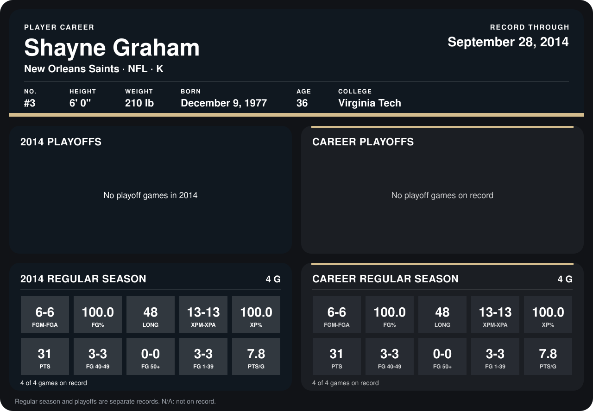

# Shayne Graham

## Career stats

### Regular season

| Season | Club | G | FGM-FGA | FG% | LONG | XPM-XPA | XP% | PTS | FG 40-49 | FG 50+ | FG 1-39 | PTS/G |
|---|---|---:|---:|---:|---:|---:|---:|---:|---:|---:|---:|---:|
| 2014 | New Orleans Saints | 5 | 9-9 | 100.0 | 50 | 14-14 | 100.0 | 41 | 3-3 | 1-1 | 5-5 | 8.2 |
| **Career** |  | 5 | 9-9 | 100.0 | 50 | 14-14 | 100.0 | 41 | 3-3 | 1-1 | 5-5 | 8.2 |

### Playoffs

No playoff games on record.

## Awards

- NFC Special Teams Player of the Week (2014, Week 3)

Records through October 5, 2014. Identity: listed 2014 roster data, Weeks 1-4; number: 2014 Week 1 roster. [All New Orleans Saints players](README.md).
