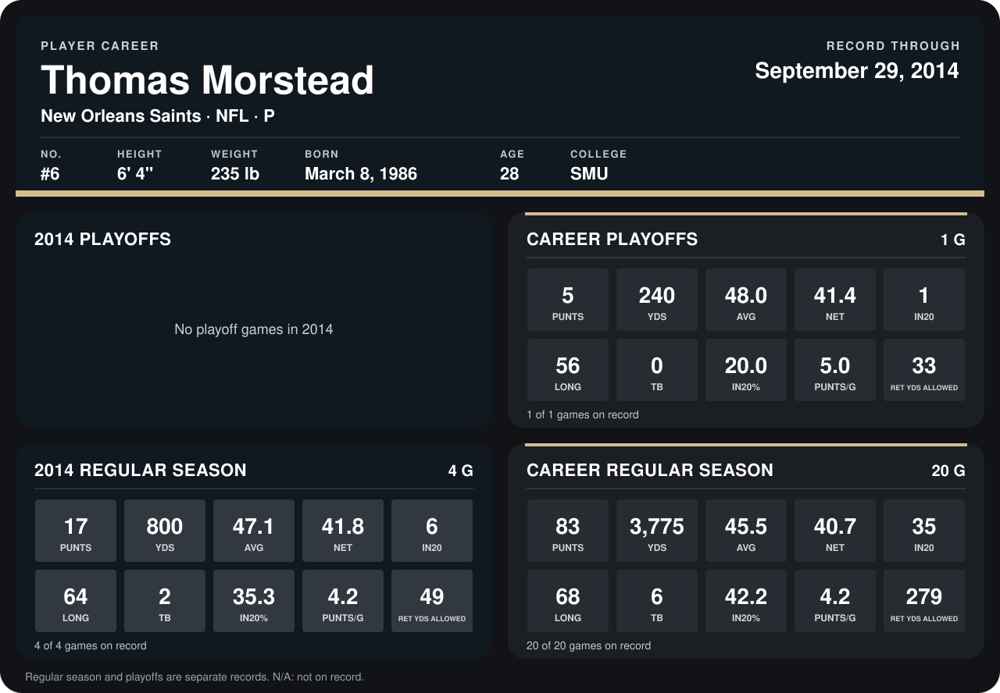

# Thomas Morstead

## Career stats

### Regular season

| Season | Club | G | PUNTS | YDS | AVG | NET | IN20 | LONG | TB | IN20% | PUNTS/G | RET YDS ALLOWED |
|---|---|---:|---:|---:|---:|---:|---:|---:|---:|---:|---:|---:|
| 2013 | New Orleans Saints | 16 | 66 | 2,975 | 45.1 | 40.4 | 29 | 68 | 4 | 43.9 | 4.1 | 230 |
| 2014 | New Orleans Saints | 5 | 20 | 938 | 46.9 | 42.2 | 7 | 64 | 2 | 35.0 | 4.0 | 53 |
| **Career** |  | 21 | 86 | 3,913 | 45.5 | 40.8 | 36 | 68 | 6 | 41.9 | 4.1 | 283 |

### Playoffs

| Season | Club | G | PUNTS | YDS | AVG | NET | IN20 | LONG | TB | IN20% | PUNTS/G | RET YDS ALLOWED |
|---|---|---:|---:|---:|---:|---:|---:|---:|---:|---:|---:|---:|
| 2013 | New Orleans Saints | 1 | 5 | 240 | 48.0 | 41.4 | 1 | 56 | 0 | 20.0 | 5.0 | 33 |
| **Career** |  | 1 | 5 | 240 | 48.0 | 41.4 | 1 | 56 | 0 | 20.0 | 5.0 | 33 |

## Awards

None on record.

Records through October 5, 2014. Identity: listed 2014 roster data, Weeks 1-4; number: 2014 Week 1 roster. [All New Orleans Saints players](README.md).
