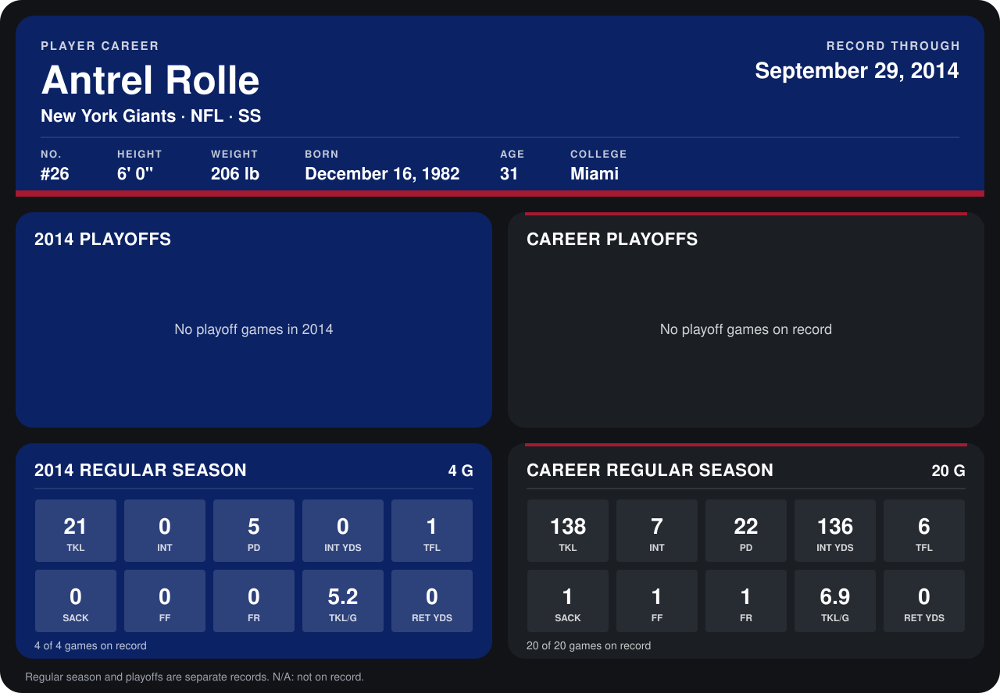

# Antrel Rolle

## Career stats

### Regular season

| Season | Club | G | TKL | INT | PD | INT YDS | TFL | SACK | FF | FR | TKL/G | RET YDS |
|---|---|---:|---:|---:|---:|---:|---:|---:|---:|---:|---:|---:|
| 2013 | New York Giants | 16 | 117 | 7 | 17 | 136 | 5 | 1 | 1 | 1 | 7.3 | 0 |
| 2014 | New York Giants | 5 | 27 | 0 | 5 | 0 | 2 | 0 | 0 | 0 | 5.4 | 0 |
| **Career** |  | 21 | 144 | 7 | 22 | 136 | 7 | 1 | 1 | 1 | 6.9 | 0 |

### Playoffs

No playoff games on record.

## Awards

- NFC Defensive Player of the Week (2013, Week 3)
- AP First-Team All-Pro (2013, S)
- Pro Bowl selection (2013, S)

Records through October 5, 2014. Identity: listed 2014 roster data, Weeks 1-4; number: 2014 Week 1 roster. [All New York Giants players](README.md).
