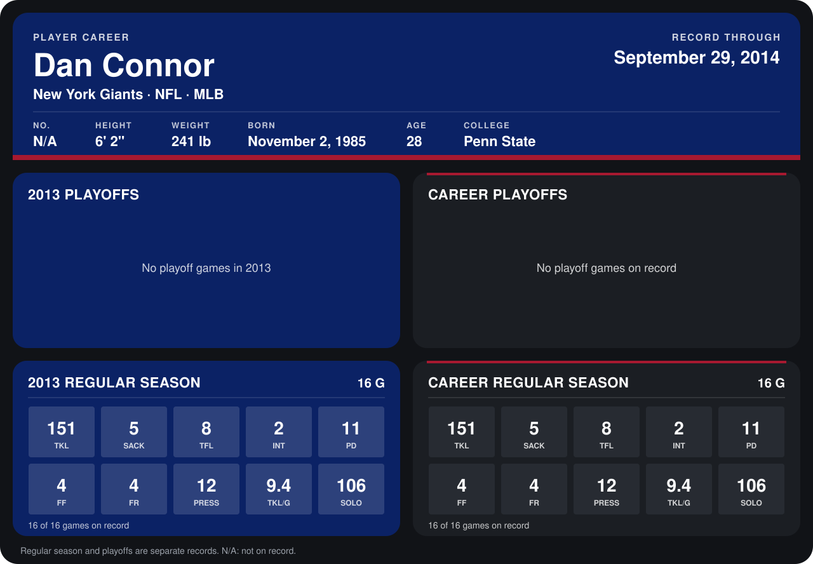

# Dan Connor

## Career stats

### Regular season

| Season | Team | Age | # | G | TKL | SACK | TFL | INT | PD | FF | FR | PRESS | TKL/G | SOLO |
|---|---|---:|---:|---:|---:|---:|---:|---:|---:|---:|---:|---:|---:|---:|
| 2013 | New York Giants | 27 | N/A | 16 | 151 | 5 | 8 | 2 | 11 | 4 | 4 | 12 | 9.4 | 106 |
| **Career** |  |  |  | 16 | 151 | 5 | 8 | 2 | 11 | 4 | 4 | 12 | 9.4 | 106 |

### Playoffs

No playoff games on record.

## Awards

- NFC Defensive Player of the Week (2013, Week 4)
- NFC Defensive Player of the Month (2013, September)
- AP First-Team All-Pro (2013, ILB)
- Pro Bowl selection (2013, ILB)

Age is his age on the league's opening game of each season; # is the number listed for him that season with that team (2014: the card's rule; 2013: the 2013 season roster), N/A where no listing applies.

Records through December 29, 2013. Identity: his listed 2013 season roster data (no 2014 Weeks 1-4 roster row). [All New York Giants players](README.md).
