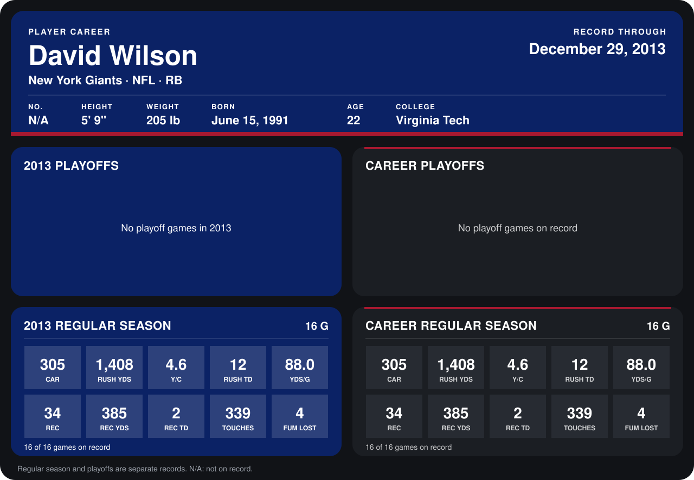

# David Wilson

## Career stats

### Regular season

| Season | Club | G | CAR | RUSH YDS | Y/C | RUSH TD | YDS/G | REC | REC YDS | REC TD | TOUCHES | FUM LOST |
|---|---|---:|---:|---:|---:|---:|---:|---:|---:|---:|---:|---:|
| 2013 | New York Giants | 16 | 305 | 1,408 | 4.6 | 12 | 88.0 | 34 | 385 | 2 | 339 | 4 |
| **Career** |  | 16 | 305 | 1,408 | 4.6 | 12 | 88.0 | 34 | 385 | 2 | 339 | 4 |

### Playoffs

No playoff games on record.

## Awards

- NFC Offensive Player of the Week (2013, Week 3)

Records through December 29, 2013. Identity: his listed 2013 season roster data (no 2014 Weeks 1-4 roster row). [All New York Giants players](README.md).
