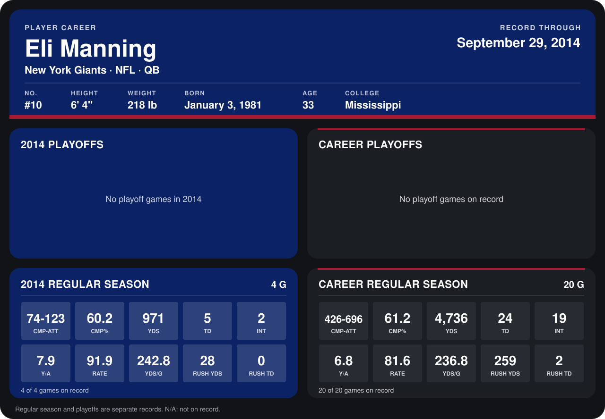

# Eli Manning

## Career stats

### Regular season

| Season | Team | Age | # | G | CMP-ATT | CMP% | YDS | TD | INT | Y/A | RATE | YDS/G | RUSH YDS | RUSH TD |
|---|---|---:|---:|---:|---:|---:|---:|---:|---:|---:|---:|---:|---:|---:|
| 2013 | New York Giants | 32 | 10 | 16 | 352-573 | 61.4 | 3,765 | 19 | 17 | 6.6 | 79.3 | 235.3 | 231 | 2 |
| 2014 | New York Giants | 33 | 10 | 5 | 89-154 | 57.8 | 1,161 | 5 | 4 | 7.5 | 81.7 | 232.2 | 29 | 0 |
| **Career** |  |  |  | 21 | 441-727 | 60.7 | 4,926 | 24 | 21 | 6.8 | 79.8 | 234.6 | 260 | 2 |

### Playoffs

No playoff games on record.

## Awards

None on record.

Age is his age on the league's opening game of each season; # is the number listed for him that season with that team (2014: the card's rule; 2013: the 2013 season roster), N/A where no listing applies.

Records through October 5, 2014. Identity: listed 2014 roster data, Weeks 1-4; number: 2014 Week 1 roster. [All New York Giants players](README.md).
