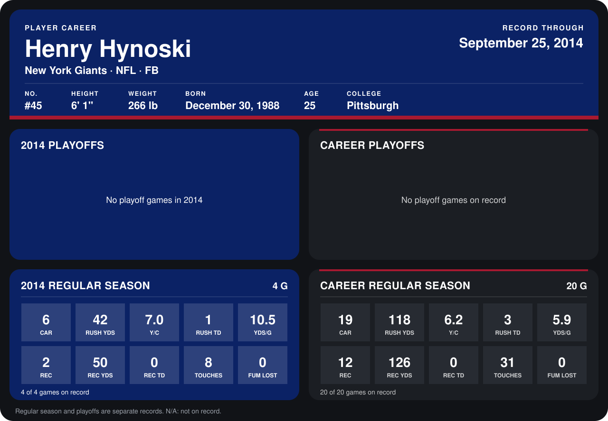

# Henry Hynoski

## Career stats

### Regular season

| Season | Team | Age | # | G | CAR | RUSH YDS | Y/C | RUSH TD | YDS/G | REC | REC YDS | REC TD | TOUCHES | FUM LOST |
|---|---|---:|---:|---:|---:|---:|---:|---:|---:|---:|---:|---:|---:|---:|
| 2013 | New York Giants | 24 | 45 | 16 | 13 | 76 | 5.8 | 2 | 4.8 | 10 | 76 | 0 | 23 | 0 |
| 2014 | New York Giants | 25 | 45 | 4 | 6 | 42 | 7.0 | 1 | 10.5 | 2 | 50 | 0 | 8 | 0 |
| **Career** |  |  |  | 20 | 19 | 118 | 6.2 | 3 | 5.9 | 12 | 126 | 0 | 31 | 0 |

### Playoffs

No playoff games on record.

## Awards

None on record.

Age is his age on the league's opening game of each season; # is the number listed for him that season with that team (2014: the card's rule; 2013: the 2013 season roster), N/A where no listing applies.

Records through September 25, 2014. Identity: listed 2014 roster data, Weeks 1-4; number: 2014 Week 1 roster. [All New York Giants players](README.md).
