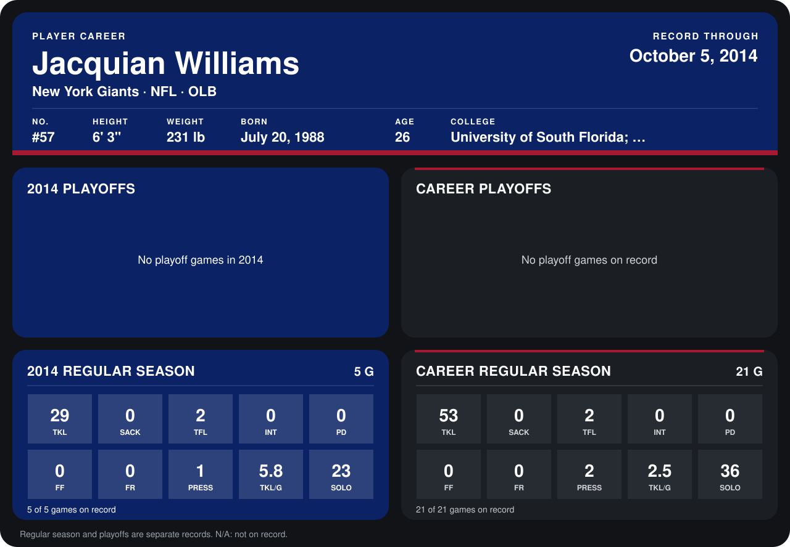

# Jacquian Williams

## Career stats

### Regular season

| Season | Team | Age | # | G | TKL | SACK | TFL | INT | PD | FF | FR | PRESS | TKL/G | SOLO |
|---|---|---:|---:|---:|---:|---:|---:|---:|---:|---:|---:|---:|---:|---:|
| 2013 | New York Giants | 25 | 57 | 16 | 24 | 0 | 0 | 0 | 0 | 0 | 0 | 1 | 1.5 | 13 |
| 2014 | New York Giants | 26 | 57 | 4 | 20 | 0 | 2 | 0 | 0 | 0 | 0 | 1 | 5.0 | 15 |
| **Career** |  |  |  | 20 | 44 | 0 | 2 | 0 | 0 | 0 | 0 | 2 | 2.2 | 28 |

### Playoffs

No playoff games on record.

## Awards

None on record.

Schools listed: University of South Florida; Fort Scott CC.

Age is his age on the league's opening game of each season; # is the number listed for him that season with that team (2014: the card's rule; 2013: the 2013 season roster), N/A where no listing applies.

Records through September 25, 2014. Identity: listed 2014 roster data, Weeks 1-4; number: 2014 Week 1 roster. [All New York Giants players](README.md).
