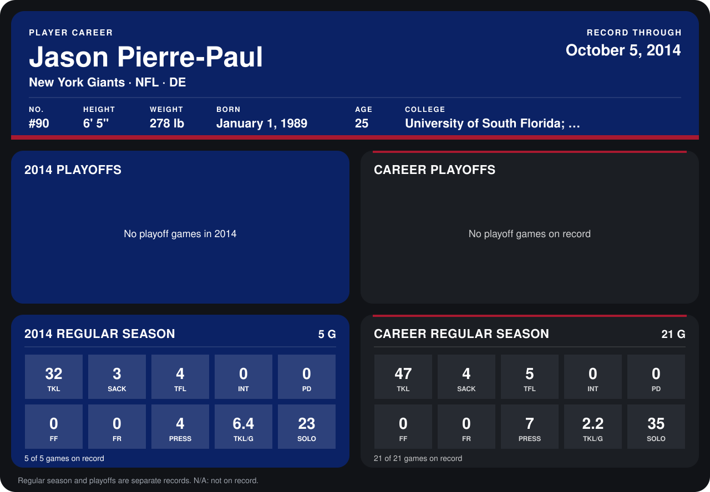

# Jason Pierre-Paul

## Career stats

### Regular season

| Season | Club | G | TKL | SACK | TFL | INT | PD | FF | FR | PRESS | TKL/G | SOLO |
|---|---|---:|---:|---:|---:|---:|---:|---:|---:|---:|---:|---:|
| 2013 | New York Giants | 16 | 15 | 1 | 1 | 0 | 0 | 0 | 0 | 3 | 0.9 | 12 |
| 2014 | New York Giants | 5 | 32 | 3 | 4 | 0 | 0 | 0 | 0 | 4 | 6.4 | 23 |
| **Career** |  | 21 | 47 | 4 | 5 | 0 | 0 | 0 | 0 | 7 | 2.2 | 35 |

### Playoffs

No playoff games on record.

## Awards

None on record.

Schools listed: University of South Florida; Fort Scott CC; College of the Canyons.

Records through October 5, 2014. Identity: listed 2014 roster data, Weeks 1-4; number: 2014 Week 1 roster. [All New York Giants players](README.md).
