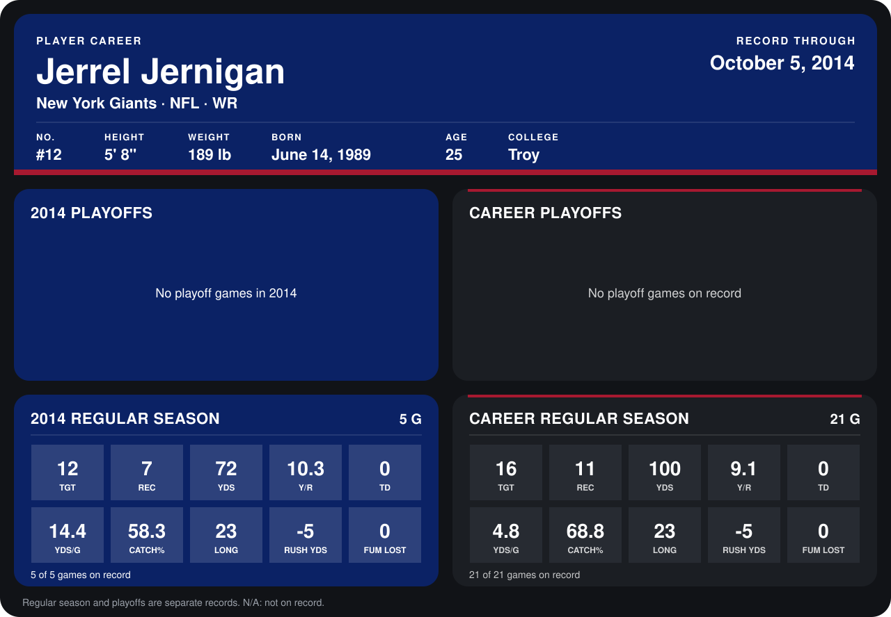

# Jerrel Jernigan

## Career stats

### Regular season

| Season | Club | G | TGT | REC | YDS | Y/R | TD | YDS/G | CATCH% | LONG | RUSH YDS | FUM LOST |
|---|---|---:|---:|---:|---:|---:|---:|---:|---:|---:|---:|---:|
| 2013 | New York Giants | 16 | 4 | 4 | 28 | 7.0 | 0 | 1.8 | 100.0 | 12 | 0 | 0 |
| 2014 | New York Giants | 4 | 8 | 6 | 49 | 8.2 | 0 | 12.2 | 75.0 | 16 | -5 | 0 |
| **Career** |  | 20 | 12 | 10 | 77 | 7.7 | 0 | 3.9 | 83.3 | 16 | -5 | 0 |

### Playoffs

No playoff games on record.

## Awards

None on record.

Records through September 25, 2014. Identity: listed 2014 roster data, Weeks 1-4; number: 2014 Week 1 roster. [All New York Giants players](README.md).
