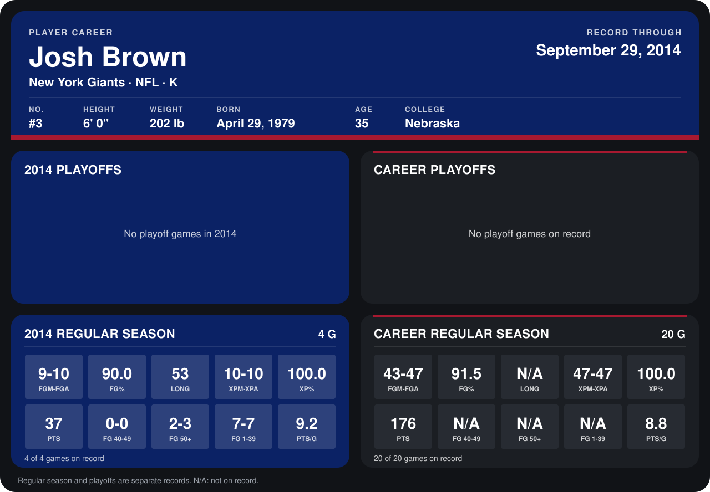

# Josh Brown

## Career stats

### Regular season

| Season | Club | G | FGM-FGA | FG% | LONG | XPM-XPA | XP% | PTS | FG 40-49 | FG 50+ | FG 1-39 | PTS/G |
|---|---|---:|---:|---:|---:|---:|---:|---:|---:|---:|---:|---:|
| 2013 | New York Giants | 16 | 34-37 | 91.9 | N/A | 37-37 | 100.0 | 139 | N/A | N/A | N/A | 8.7 |
| 2014 | New York Giants | 4 | 9-10 | 90.0 | 53 | 10-10 | 100.0 | 37 | 0-0 | 2-3 | 7-7 | 9.2 |
| **Career** |  | 20 | 43-47 | 91.5 | N/A | 47-47 | 100.0 | 176 | N/A | N/A | N/A | 8.8 |

### Playoffs

No playoff games on record.

## Awards

- NFC Special Teams Player of the Week (2014, Week 4)

Records through September 25, 2014. Identity: listed 2014 roster data, Weeks 1-4; number: 2014 Week 1 roster. [All New York Giants players](README.md).
