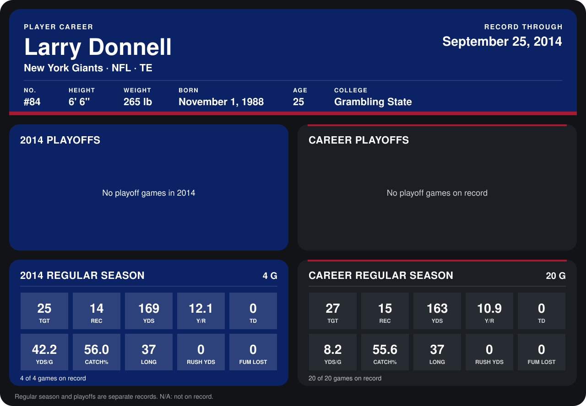

# Larry Donnell

## Career stats

### Regular season

| Season | Club | G | TGT | REC | YDS | Y/R | TD | YDS/G | CATCH% | LONG | RUSH YDS | FUM LOST |
|---|---|---:|---:|---:|---:|---:|---:|---:|---:|---:|---:|---:|
| 2013 | New York Giants | 16 | 2 | 1 | -6 | -6.0 | 0 | -0.4 | 50.0 | 0 | 0 | 0 |
| 2014 | New York Giants | 5 | 31 | 18 | 219 | 12.2 | 0 | 43.8 | 58.1 | 37 | 0 | 0 |
| **Career** |  | 21 | 33 | 19 | 213 | 11.2 | 0 | 10.1 | 57.6 | 37 | 0 | 0 |

### Playoffs

No playoff games on record.

## Awards

None on record.

Records through October 5, 2014. Identity: listed 2014 roster data, Weeks 1-4; number: 2014 Week 1 roster. [All New York Giants players](README.md).
