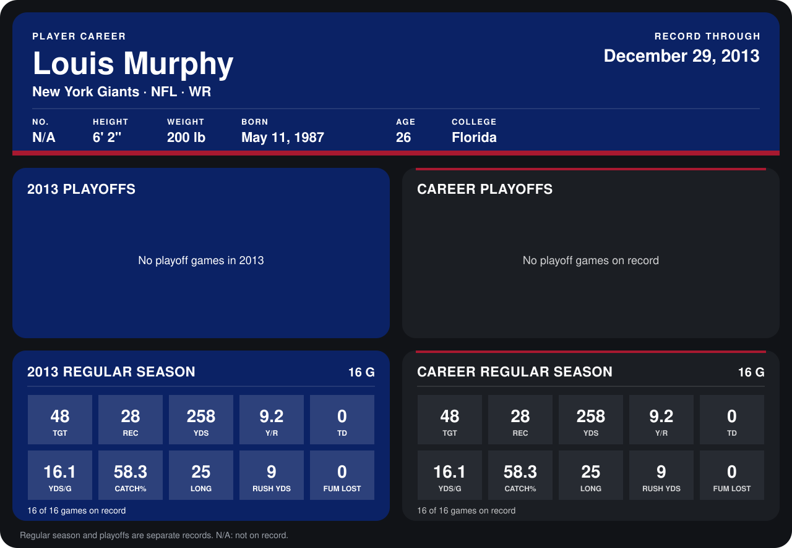

# Louis Murphy

## Career stats

### Regular season

| Season | Club | G | TGT | REC | YDS | Y/R | TD | YDS/G | CATCH% | LONG | RUSH YDS | FUM LOST |
|---|---|---:|---:|---:|---:|---:|---:|---:|---:|---:|---:|---:|
| 2013 | New York Giants | 16 | 48 | 28 | 258 | 9.2 | 0 | 16.1 | 58.3 | 25 | 9 | 0 |
| **Career** |  | 16 | 48 | 28 | 258 | 9.2 | 0 | 16.1 | 58.3 | 25 | 9 | 0 |

### Playoffs

No playoff games on record.

## Awards

None on record.

Records through September 29, 2014. Identity: listed 2014 roster data, Weeks 1-4. [All New York Giants players](README.md).
