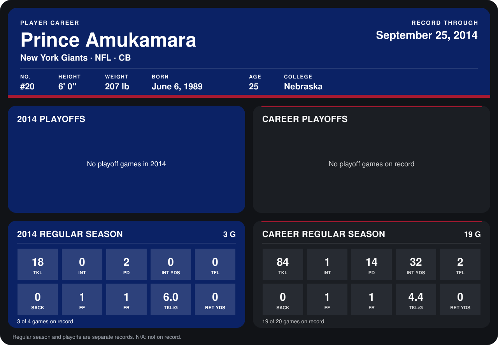

# Prince Amukamara

## Career stats

### Regular season

| Season | Club | G | TKL | INT | PD | INT YDS | TFL | SACK | FF | FR | TKL/G | RET YDS |
|---|---|---:|---:|---:|---:|---:|---:|---:|---:|---:|---:|---:|
| 2013 | New York Giants | 16 | 66 | 1 | 12 | 32 | 2 | 0 | 0 | 0 | 4.1 | 0 |
| 2014 | New York Giants | 3 | 18 | 0 | 2 | 0 | 0 | 0 | 1 | 1 | 6.0 | 0 |
| **Career** |  | 19 | 84 | 1 | 14 | 32 | 2 | 0 | 1 | 1 | 4.4 | 0 |

### Playoffs

No playoff games on record.

## Awards

None on record.

Records through September 25, 2014. Identity: listed 2014 roster data, Weeks 1-4; number: 2014 Week 1 roster. [All New York Giants players](README.md).
