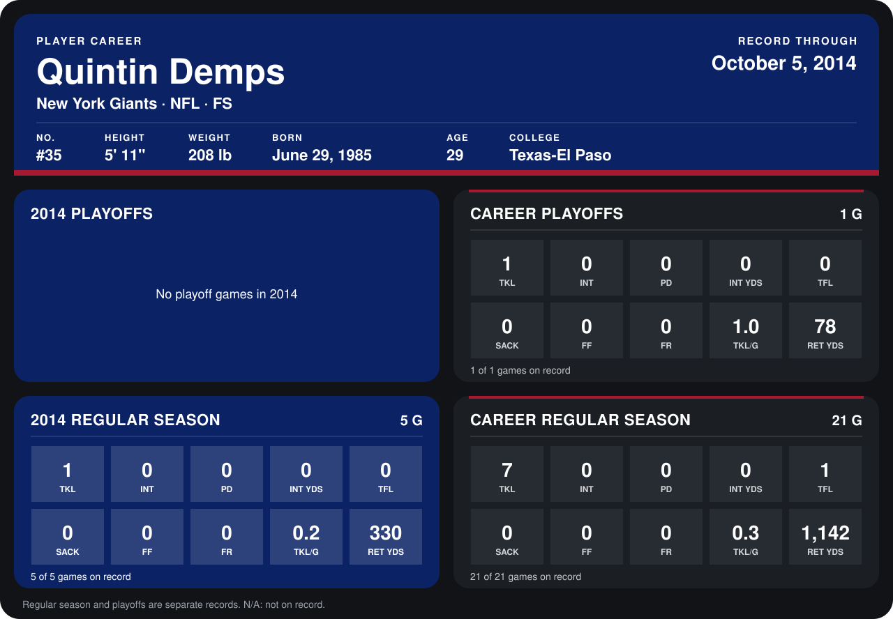

# Quintin Demps

## Career stats

### Regular season

| Season | Club | G | TKL | INT | PD | INT YDS | TFL | SACK | FF | FR | TKL/G | RET YDS |
|---|---|---:|---:|---:|---:|---:|---:|---:|---:|---:|---:|---:|
| 2013 | Kansas City Chiefs | 16 | 6 | 0 | 0 | 0 | 1 | 0 | 0 | 0 | 0.4 | 812 |
| 2014 | New York Giants | 5 | 1 | 0 | 0 | 0 | 0 | 0 | 0 | 0 | 0.2 | 330 |
| **Career** |  | 21 | 7 | 0 | 0 | 0 | 1 | 0 | 0 | 0 | 0.3 | 1,142 |

### Playoffs

| Season | Club | G | TKL | INT | PD | INT YDS | TFL | SACK | FF | FR | TKL/G | RET YDS |
|---|---|---:|---:|---:|---:|---:|---:|---:|---:|---:|---:|---:|
| 2013 | Kansas City Chiefs | 1 | 1 | 0 | 0 | 0 | 0 | 0 | 0 | 0 | 1.0 | 78 |
| **Career** |  | 1 | 1 | 0 | 0 | 0 | 0 | 0 | 0 | 0 | 1.0 | 78 |

## Awards

None on record.

Records through October 5, 2014. Identity: listed 2014 roster data, Weeks 1-4; number: 2014 Week 1 roster. [All New York Giants players](README.md).
