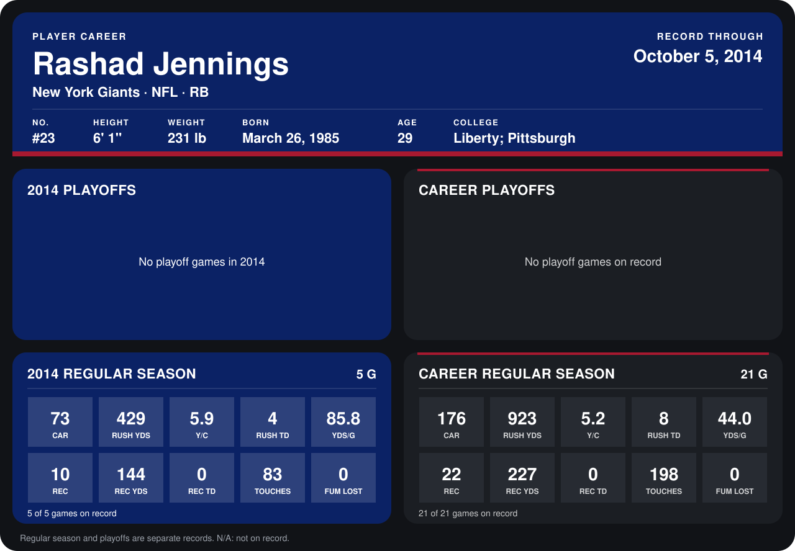

# Rashad Jennings

## Career stats

### Regular season

| Season | Team | Age | # | G | CAR | RUSH YDS | Y/C | RUSH TD | YDS/G | REC | REC YDS | REC TD | TOUCHES | FUM LOST |
|---|---|---:|---:|---:|---:|---:|---:|---:|---:|---:|---:|---:|---:|---:|
| 2013 | Oakland Raiders | 28 | 27 | 16 | 103 | 494 | 4.8 | 4 | 30.9 | 12 | 83 | 0 | 115 | 0 |
| 2014 | New York Giants | 29 | 23 | 4 | 61 | 343 | 5.6 | 3 | 85.8 | 6 | 92 | 0 | 67 | 0 |
| **Career** |  |  |  | 20 | 164 | 837 | 5.1 | 7 | 41.9 | 18 | 175 | 0 | 182 | 0 |

### Playoffs

No playoff games on record.

## Awards

None on record.

Age is his age on the league's opening game of each season; # is the number listed for him that season with that team (2014: the card's rule; 2013: the 2013 season roster), N/A where no listing applies.

Records through September 25, 2014. Identity: listed 2014 roster data, Weeks 1-4; number: 2014 Week 1 roster. [All New York Giants players](README.md).
