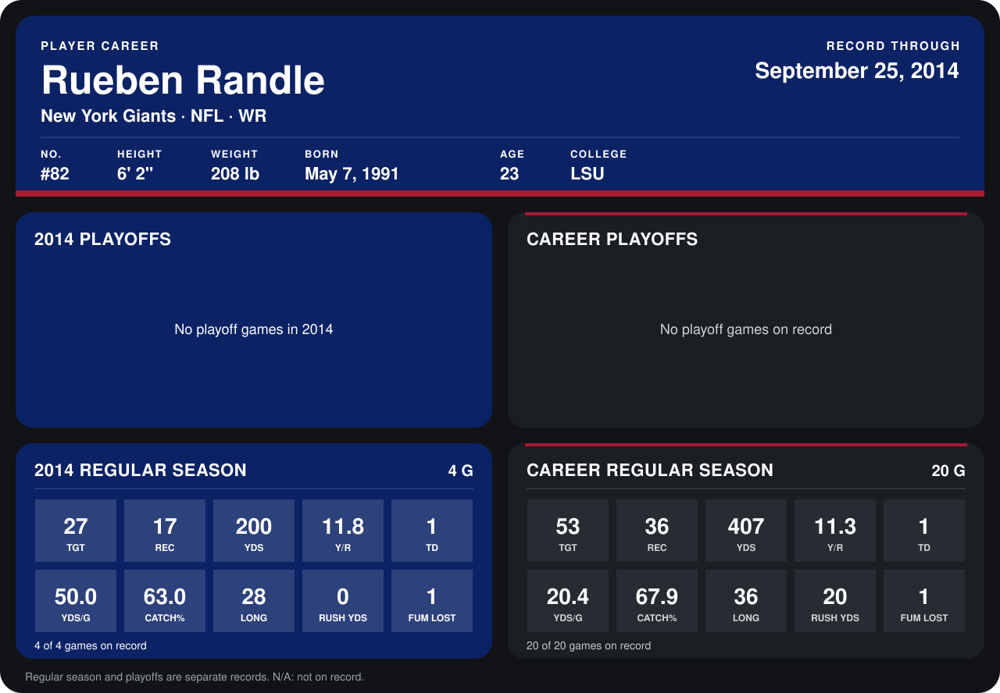

# Rueben Randle

## Career stats

### Regular season

| Season | Club | G | TGT | REC | YDS | Y/R | TD | YDS/G | CATCH% | LONG | RUSH YDS | FUM LOST |
|---|---|---:|---:|---:|---:|---:|---:|---:|---:|---:|---:|---:|
| 2013 | New York Giants | 16 | 26 | 19 | 207 | 10.9 | 0 | 12.9 | 73.1 | 36 | 20 | 0 |
| 2014 | New York Giants | 5 | 32 | 19 | 209 | 11.0 | 1 | 41.8 | 59.4 | 28 | 2 | 1 |
| **Career** |  | 21 | 58 | 38 | 416 | 10.9 | 1 | 19.8 | 65.5 | 36 | 22 | 1 |

### Playoffs

No playoff games on record.

## Awards

None on record.

Records through October 5, 2014. Identity: listed 2014 roster data, Weeks 1-4; number: 2014 Week 1 roster. [All New York Giants players](README.md).
