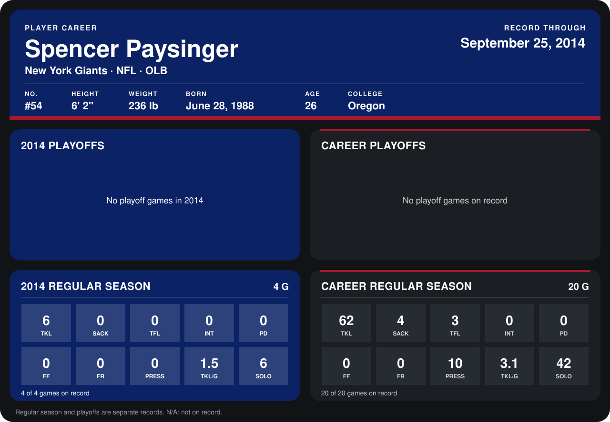

# Spencer Paysinger

## Career stats

### Regular season

| Season | Club | G | TKL | SACK | TFL | INT | PD | FF | FR | PRESS | TKL/G | SOLO |
|---|---|---:|---:|---:|---:|---:|---:|---:|---:|---:|---:|---:|
| 2013 | New York Giants | 16 | 56 | 4 | 3 | 0 | 0 | 0 | 0 | 10 | 3.5 | 36 |
| 2014 | New York Giants | 5 | 7 | 0 | 1 | 0 | 1 | 0 | 0 | 0 | 1.4 | 6 |
| **Career** |  | 21 | 63 | 4 | 4 | 0 | 1 | 0 | 0 | 10 | 3.0 | 42 |

### Playoffs

No playoff games on record.

## Awards

None on record.

Records through October 5, 2014. Identity: listed 2014 roster data, Weeks 1-4; number: 2014 Week 1 roster. [All New York Giants players](README.md).
