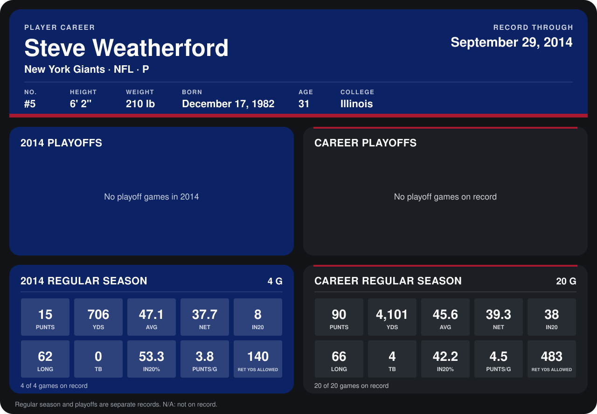

# Steve Weatherford

## Career stats

### Regular season

| Season | Club | G | PUNTS | YDS | AVG | NET | IN20 | LONG | TB | IN20% | PUNTS/G | RET YDS ALLOWED |
|---|---|---:|---:|---:|---:|---:|---:|---:|---:|---:|---:|---:|
| 2013 | New York Giants | 16 | 75 | 3,395 | 45.3 | 39.6 | 30 | 66 | 4 | 40.0 | 4.7 | 343 |
| 2014 | New York Giants | 4 | 15 | 706 | 47.1 | 37.7 | 8 | 62 | 0 | 53.3 | 3.8 | 140 |
| **Career** |  | 20 | 90 | 4,101 | 45.6 | 39.3 | 38 | 66 | 4 | 42.2 | 4.5 | 483 |

### Playoffs

No playoff games on record.

## Awards

None on record.

Records through September 29, 2014. Identity: listed 2014 roster data, Weeks 1-4; number: 2014 Week 1 roster. [All New York Giants players](README.md).
