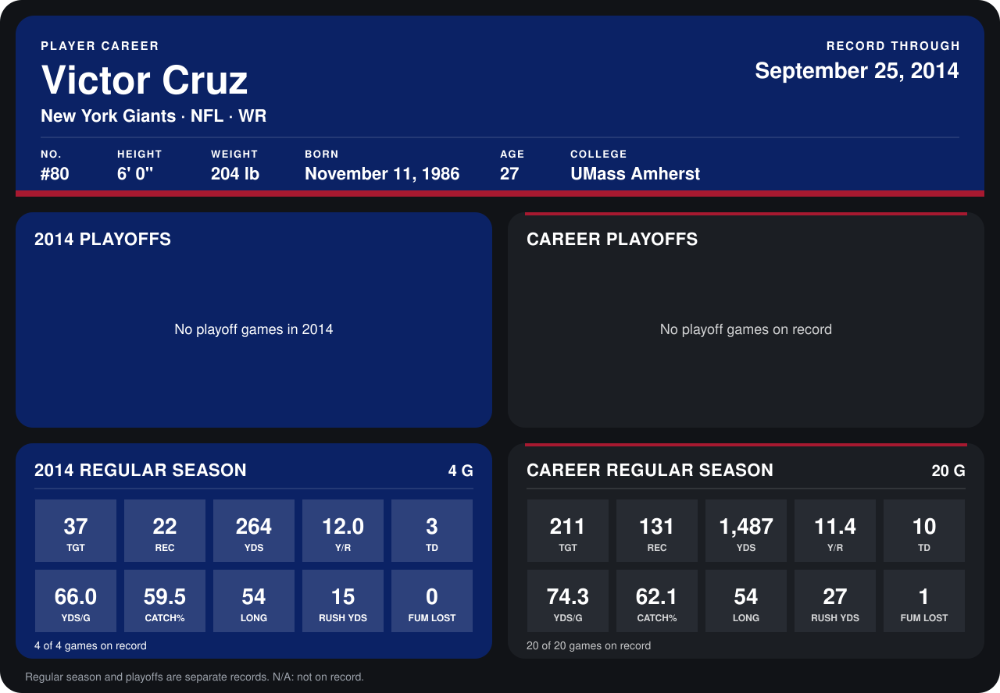

# Victor Cruz

## Career stats

### Regular season

| Season | Club | G | TGT | REC | YDS | Y/R | TD | YDS/G | CATCH% | LONG | RUSH YDS | FUM LOST |
|---|---|---:|---:|---:|---:|---:|---:|---:|---:|---:|---:|---:|
| 2013 | New York Giants | 16 | 174 | 109 | 1,223 | 11.2 | 7 | 76.4 | 62.6 | 54 | 12 | 1 |
| 2014 | New York Giants | 4 | 37 | 22 | 264 | 12.0 | 3 | 66.0 | 59.5 | 54 | 15 | 0 |
| **Career** |  | 20 | 211 | 131 | 1,487 | 11.4 | 10 | 74.3 | 62.1 | 54 | 27 | 1 |

### Playoffs

No playoff games on record.

## Awards

None on record.

Records through September 29, 2014. Identity: listed 2014 roster data, Weeks 1-4; number: 2014 Week 1 roster. [All New York Giants players](README.md).
