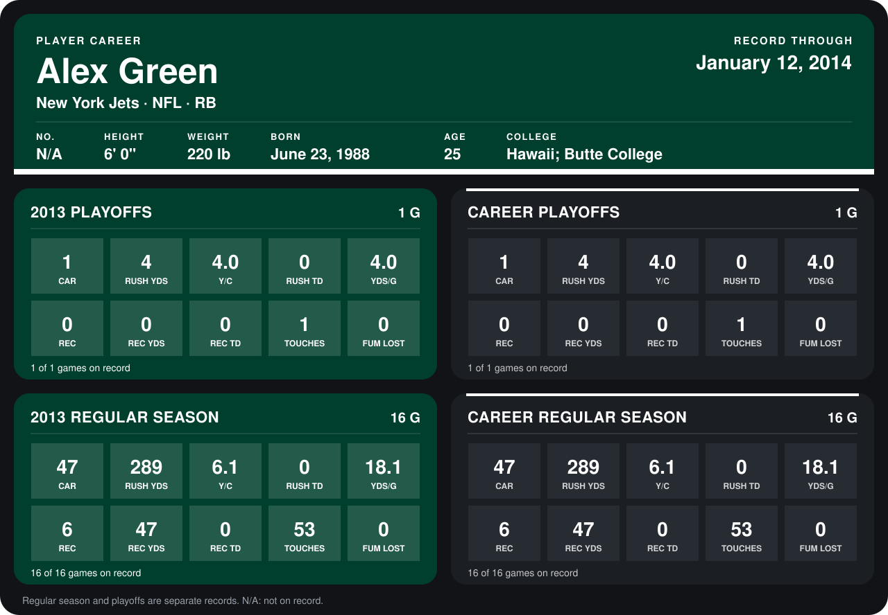

# Alex Green

## Career stats

### Regular season

| Season | Club | G | CAR | RUSH YDS | Y/C | RUSH TD | YDS/G | REC | REC YDS | REC TD | TOUCHES | FUM LOST |
|---|---|---:|---:|---:|---:|---:|---:|---:|---:|---:|---:|---:|
| 2013 | New York Jets | 16 | 47 | 289 | 6.1 | 0 | 18.1 | 6 | 47 | 0 | 53 | 0 |
| **Career** |  | 16 | 47 | 289 | 6.1 | 0 | 18.1 | 6 | 47 | 0 | 53 | 0 |

### Playoffs

| Season | Club | G | CAR | RUSH YDS | Y/C | RUSH TD | YDS/G | REC | REC YDS | REC TD | TOUCHES | FUM LOST |
|---|---|---:|---:|---:|---:|---:|---:|---:|---:|---:|---:|---:|
| 2013 | New York Jets | 1 | 1 | 4 | 4.0 | 0 | 4.0 | 0 | 0 | 0 | 1 | 0 |
| **Career** |  | 1 | 1 | 4 | 4.0 | 0 | 4.0 | 0 | 0 | 0 | 1 | 0 |

## Awards

None on record.

Records through September 29, 2014. Identity: the public player file's latest listing (no 2014 Weeks 1-4 roster row). [All New York Jets players](README.md).
