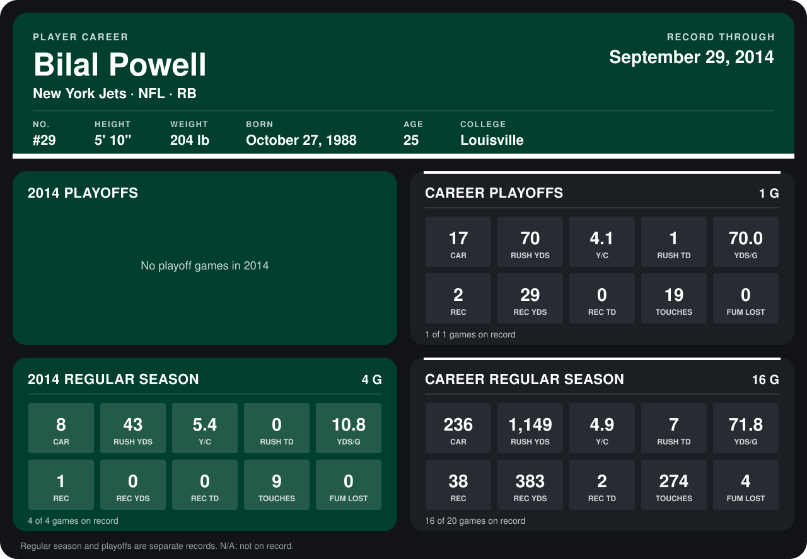

# Bilal Powell

## Career stats

### Regular season

| Season | Club | G | CAR | RUSH YDS | Y/C | RUSH TD | YDS/G | REC | REC YDS | REC TD | TOUCHES | FUM LOST |
|---|---|---:|---:|---:|---:|---:|---:|---:|---:|---:|---:|---:|
| 2013 | New York Jets | 12 | 228 | 1,106 | 4.9 | 7 | 92.2 | 37 | 383 | 2 | 265 | 4 |
| 2014 | New York Jets | 4 | 8 | 43 | 5.4 | 0 | 10.8 | 1 | 0 | 0 | 9 | 0 |
| **Career** |  | 16 | 236 | 1,149 | 4.9 | 7 | 71.8 | 38 | 383 | 2 | 274 | 4 |

### Playoffs

| Season | Club | G | CAR | RUSH YDS | Y/C | RUSH TD | YDS/G | REC | REC YDS | REC TD | TOUCHES | FUM LOST |
|---|---|---:|---:|---:|---:|---:|---:|---:|---:|---:|---:|---:|
| 2013 | New York Jets | 1 | 17 | 70 | 4.1 | 1 | 70.0 | 2 | 29 | 0 | 19 | 0 |
| **Career** |  | 1 | 17 | 70 | 4.1 | 1 | 70.0 | 2 | 29 | 0 | 19 | 0 |

## Awards

None on record.

Records through September 29, 2014. Identity: listed 2014 roster data, Weeks 1-4; number: 2014 Week 1 roster. [All New York Jets players](README.md).
