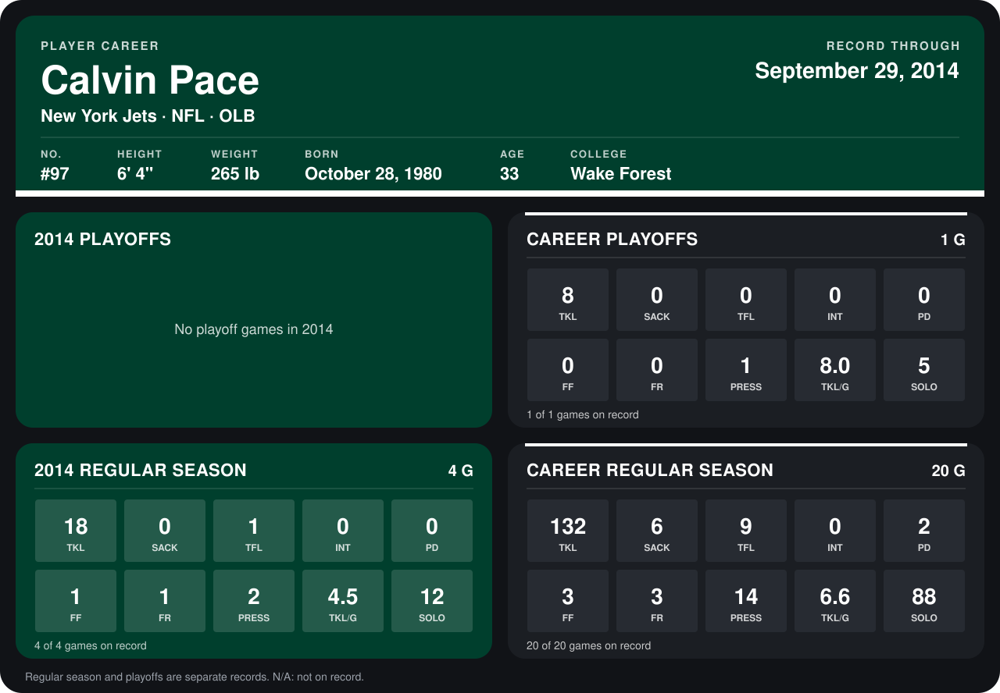

# Calvin Pace

## Career stats

### Regular season

| Season | Club | G | TKL | SACK | TFL | INT | PD | FF | FR | PRESS | TKL/G | SOLO |
|---|---|---:|---:|---:|---:|---:|---:|---:|---:|---:|---:|---:|
| 2013 | New York Jets | 16 | 114 | 6 | 8 | 0 | 2 | 2 | 2 | 12 | 7.1 | 76 |
| 2014 | New York Jets | 5 | 22 | 0 | 1 | 0 | 0 | 1 | 1 | 2 | 4.4 | 14 |
| **Career** |  | 21 | 136 | 6 | 9 | 0 | 2 | 3 | 3 | 14 | 6.5 | 90 |

### Playoffs

| Season | Club | G | TKL | SACK | TFL | INT | PD | FF | FR | PRESS | TKL/G | SOLO |
|---|---|---:|---:|---:|---:|---:|---:|---:|---:|---:|---:|---:|
| 2013 | New York Jets | 1 | 8 | 0 | 0 | 0 | 0 | 0 | 0 | 1 | 8.0 | 5 |
| **Career** |  | 1 | 8 | 0 | 0 | 0 | 0 | 0 | 0 | 1 | 8.0 | 5 |

## Awards

None on record.

Records through October 5, 2014. Identity: listed 2014 roster data, Weeks 1-4; number: 2014 Week 1 roster. [All New York Jets players](README.md).
