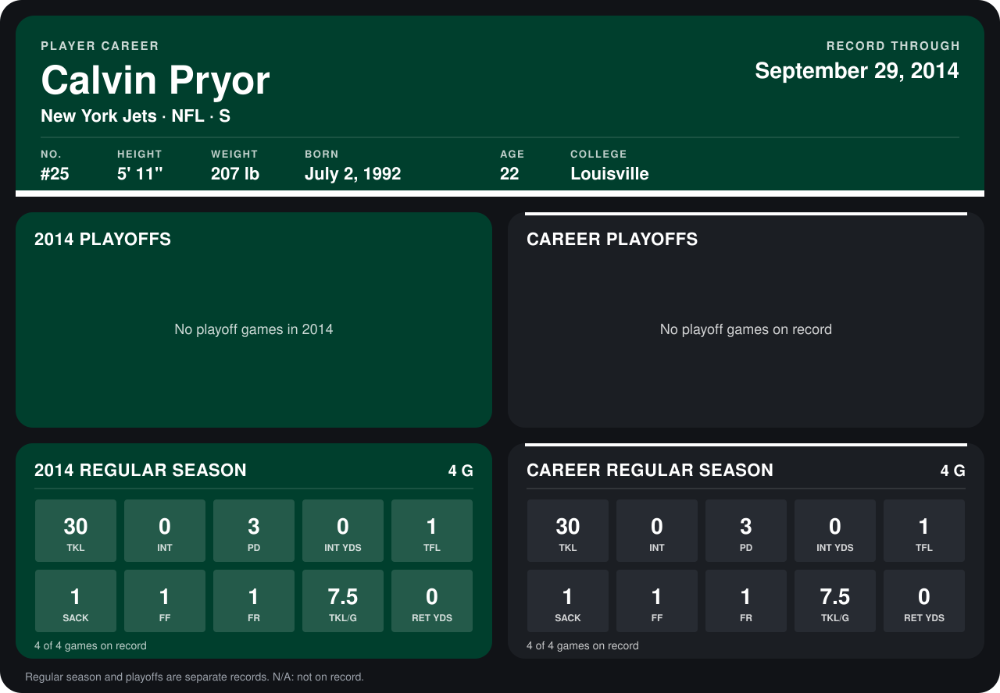

# Calvin Pryor

## Career stats

### Regular season

| Season | Club | G | TKL | INT | PD | INT YDS | TFL | SACK | FF | FR | TKL/G | RET YDS |
|---|---|---:|---:|---:|---:|---:|---:|---:|---:|---:|---:|---:|
| 2014 | New York Jets | 4 | 30 | 0 | 3 | 0 | 1 | 1 | 1 | 1 | 7.5 | 0 |
| **Career** |  | 4 | 30 | 0 | 3 | 0 | 1 | 1 | 1 | 1 | 7.5 | 0 |

### Playoffs

No playoff games on record.

## Awards

None on record.

Records through September 28, 2014. Identity: listed 2014 roster data, Weeks 1-4; number: 2014 Week 1 roster. [All New York Jets players](README.md).
