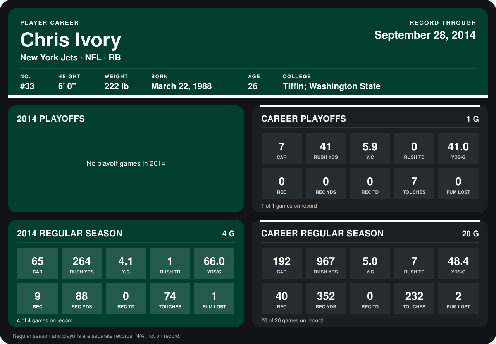

# Chris Ivory

## Career stats

### Regular season

| Season | Team | Age | # | G | CAR | RUSH YDS | Y/C | RUSH TD | YDS/G | REC | REC YDS | REC TD | TOUCHES | FUM LOST |
|---|---|---:|---:|---:|---:|---:|---:|---:|---:|---:|---:|---:|---:|---:|
| 2013 | New York Jets | 25 | 33 | 16 | 127 | 703 | 5.5 | 6 | 43.9 | 31 | 264 | 0 | 158 | 1 |
| 2014 | New York Jets | 26 | 33 | 4 | 65 | 264 | 4.1 | 1 | 66.0 | 9 | 88 | 0 | 74 | 1 |
| **Career** |  |  |  | 20 | 192 | 967 | 5.0 | 7 | 48.4 | 40 | 352 | 0 | 232 | 2 |

### Playoffs

| Season | Team | Age | # | G | CAR | RUSH YDS | Y/C | RUSH TD | YDS/G | REC | REC YDS | REC TD | TOUCHES | FUM LOST |
|---|---|---:|---:|---:|---:|---:|---:|---:|---:|---:|---:|---:|---:|---:|
| 2013 | New York Jets | 25 | 33 | 1 | 7 | 41 | 5.9 | 0 | 41.0 | 0 | 0 | 0 | 7 | 0 |
| **Career** |  |  |  | 1 | 7 | 41 | 5.9 | 0 | 41.0 | 0 | 0 | 0 | 7 | 0 |

## Awards

None on record.

Age is his age on the league's opening game of each season; # is the number listed for him that season with that team (2014: the card's rule; 2013: the 2013 season roster), N/A where no listing applies.

Records through September 28, 2014. Identity: listed 2014 roster data, Weeks 1-4; number: 2014 Week 1 roster. [All New York Jets players](README.md).
