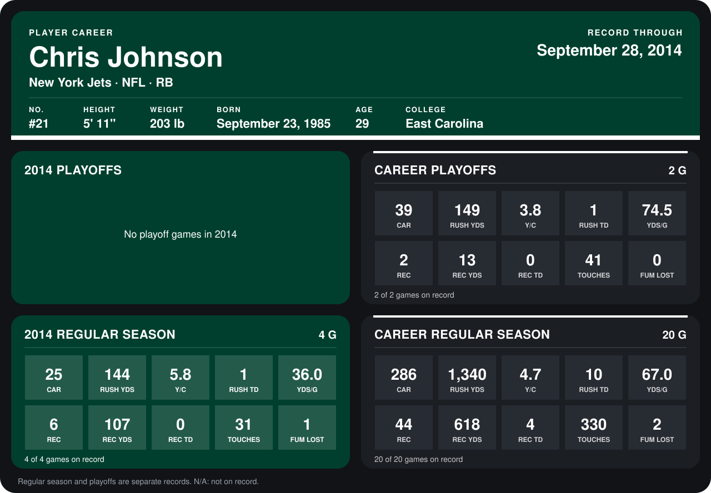

# Chris Johnson

## Career stats

### Regular season

| Season | Team | Age | # | G | CAR | RUSH YDS | Y/C | RUSH TD | YDS/G | REC | REC YDS | REC TD | TOUCHES | FUM LOST |
|---|---|---:|---:|---:|---:|---:|---:|---:|---:|---:|---:|---:|---:|---:|
| 2013 | Tennessee Titans | 27 | 28 | 16 | 261 | 1,196 | 4.6 | 9 | 74.8 | 38 | 511 | 4 | 299 | 1 |
| 2014 | New York Jets | 28 | 21 | 5 | 27 | 146 | 5.4 | 1 | 29.2 | 6 | 107 | 0 | 33 | 1 |
| **Career** |  |  |  | 21 | 288 | 1,342 | 4.7 | 10 | 63.9 | 44 | 618 | 4 | 332 | 2 |

### Playoffs

| Season | Team | Age | # | G | CAR | RUSH YDS | Y/C | RUSH TD | YDS/G | REC | REC YDS | REC TD | TOUCHES | FUM LOST |
|---|---|---:|---:|---:|---:|---:|---:|---:|---:|---:|---:|---:|---:|---:|
| 2013 | Tennessee Titans | 27 | 28 | 2 | 39 | 149 | 3.8 | 1 | 74.5 | 2 | 13 | 0 | 41 | 0 |
| **Career** |  |  |  | 2 | 39 | 149 | 3.8 | 1 | 74.5 | 2 | 13 | 0 | 41 | 0 |

## Awards

- AFC Offensive Player of the Week (2013, Week 14)

Age is his age on the league's opening game of each season; # is the number listed for him that season with that team (2014: the card's rule; 2013: the 2013 season roster), N/A where no listing applies.

Records through October 5, 2014. Identity: listed 2014 roster data, Weeks 1-4; number: 2014 Week 1 roster. [All New York Jets players](README.md).
