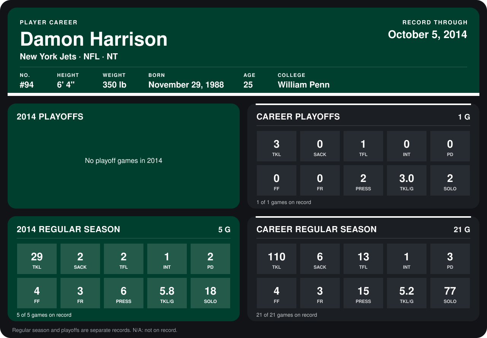

# Damon Harrison

## Career stats

### Regular season

| Season | Club | G | TKL | SACK | TFL | INT | PD | FF | FR | PRESS | TKL/G | SOLO |
|---|---|---:|---:|---:|---:|---:|---:|---:|---:|---:|---:|---:|
| 2013 | New York Jets | 16 | 81 | 4 | 11 | 0 | 1 | 0 | 0 | 9 | 5.1 | 59 |
| 2014 | New York Jets | 5 | 29 | 2 | 2 | 1 | 2 | 4 | 3 | 6 | 5.8 | 18 |
| **Career** |  | 21 | 110 | 6 | 13 | 1 | 3 | 4 | 3 | 15 | 5.2 | 77 |

### Playoffs

| Season | Club | G | TKL | SACK | TFL | INT | PD | FF | FR | PRESS | TKL/G | SOLO |
|---|---|---:|---:|---:|---:|---:|---:|---:|---:|---:|---:|---:|
| 2013 | New York Jets | 1 | 3 | 0 | 1 | 0 | 0 | 0 | 0 | 2 | 3.0 | 2 |
| **Career** |  | 1 | 3 | 0 | 1 | 0 | 0 | 0 | 0 | 2 | 3.0 | 2 |

## Awards

None on record.

Records through October 5, 2014. Identity: listed 2014 roster data, Weeks 1-4; number: 2014 Week 1 roster. [All New York Jets players](README.md).
