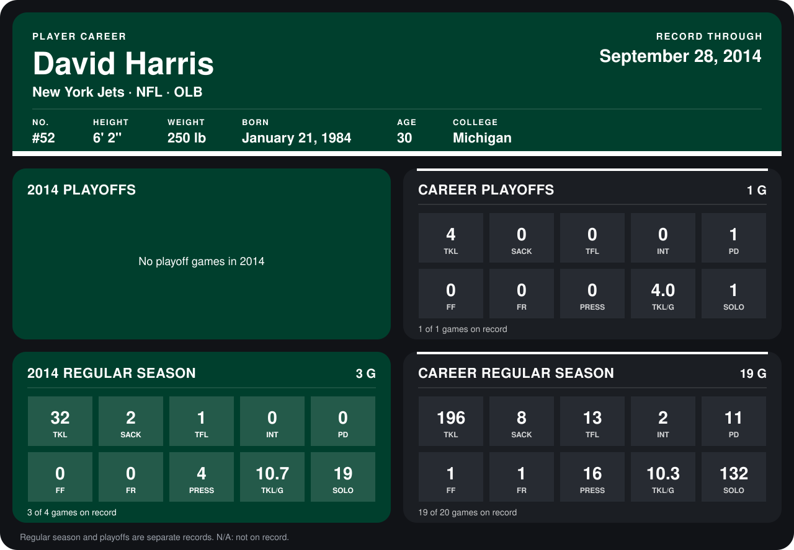

# David Harris

## Career stats

### Regular season

| Season | Club | G | TKL | SACK | TFL | INT | PD | FF | FR | PRESS | TKL/G | SOLO |
|---|---|---:|---:|---:|---:|---:|---:|---:|---:|---:|---:|---:|
| 2013 | New York Jets | 16 | 164 | 6 | 12 | 2 | 11 | 1 | 1 | 12 | 10.2 | 113 |
| 2014 | New York Jets | 4 | 40 | 3 | 1 | 0 | 0 | 0 | 0 | 7 | 10.0 | 26 |
| **Career** |  | 20 | 204 | 9 | 13 | 2 | 11 | 1 | 1 | 19 | 10.2 | 139 |

### Playoffs

| Season | Club | G | TKL | SACK | TFL | INT | PD | FF | FR | PRESS | TKL/G | SOLO |
|---|---|---:|---:|---:|---:|---:|---:|---:|---:|---:|---:|---:|
| 2013 | New York Jets | 1 | 4 | 0 | 0 | 0 | 1 | 0 | 0 | 0 | 4.0 | 1 |
| **Career** |  | 1 | 4 | 0 | 0 | 0 | 1 | 0 | 0 | 0 | 4.0 | 1 |

## Awards

- AP Defensive Player of the Year (2013)
- AP First-Team All-Pro (2013, OLB)
- Pro Bowl selection (2013, OLB)

Records through October 5, 2014. Identity: listed 2014 roster data, Weeks 1-4; number: 2014 Week 1 roster. [All New York Jets players](README.md).
