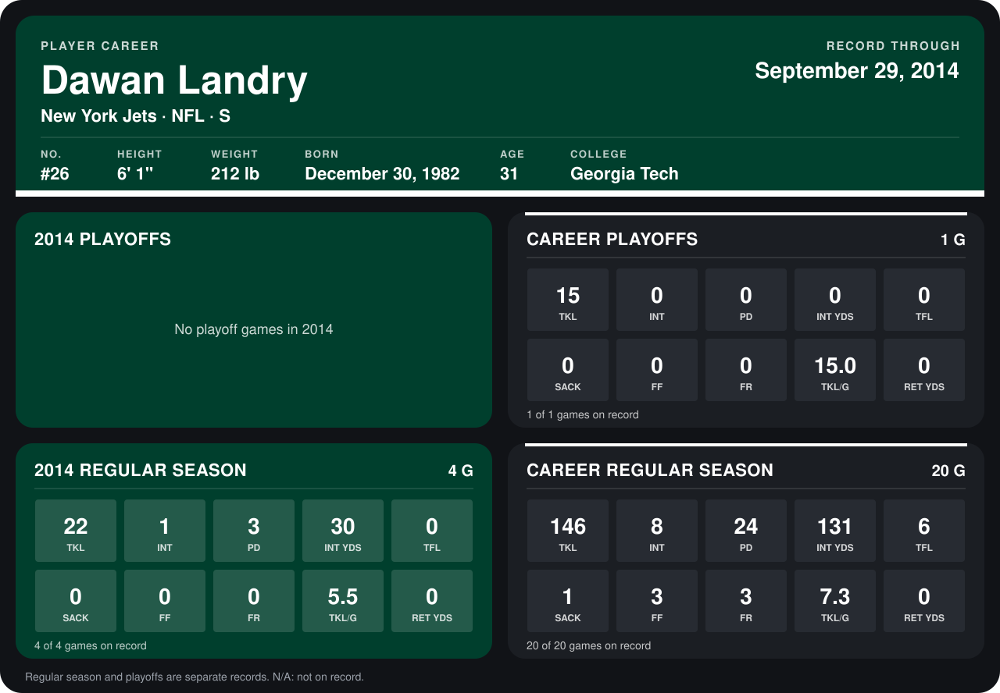

# Dawan Landry

## Career stats

### Regular season

| Season | Club | G | TKL | INT | PD | INT YDS | TFL | SACK | FF | FR | TKL/G | RET YDS |
|---|---|---:|---:|---:|---:|---:|---:|---:|---:|---:|---:|---:|
| 2013 | New York Jets | 16 | 124 | 7 | 21 | 101 | 6 | 1 | 3 | 3 | 7.8 | 0 |
| 2014 | New York Jets | 5 | 27 | 1 | 3 | 30 | 0 | 0 | 0 | 0 | 5.4 | 0 |
| **Career** |  | 21 | 151 | 8 | 24 | 131 | 6 | 1 | 3 | 3 | 7.2 | 0 |

### Playoffs

| Season | Club | G | TKL | INT | PD | INT YDS | TFL | SACK | FF | FR | TKL/G | RET YDS |
|---|---|---:|---:|---:|---:|---:|---:|---:|---:|---:|---:|---:|
| 2013 | New York Jets | 1 | 15 | 0 | 0 | 0 | 0 | 0 | 0 | 0 | 15.0 | 0 |
| **Career** |  | 1 | 15 | 0 | 0 | 0 | 0 | 0 | 0 | 0 | 15.0 | 0 |

## Awards

- AFC Defensive Player of the Week (2013, Week 5)
- AFC Defensive Player of the Week (2013, Week 6)
- AFC Defensive Player of the Month (2013, October)
- AP First-Team All-Pro (2013, S)
- Pro Bowl selection (2013, S)

Records through October 5, 2014. Identity: listed 2014 roster data, Weeks 1-4; number: 2014 Week 1 roster. [All New York Jets players](README.md).
