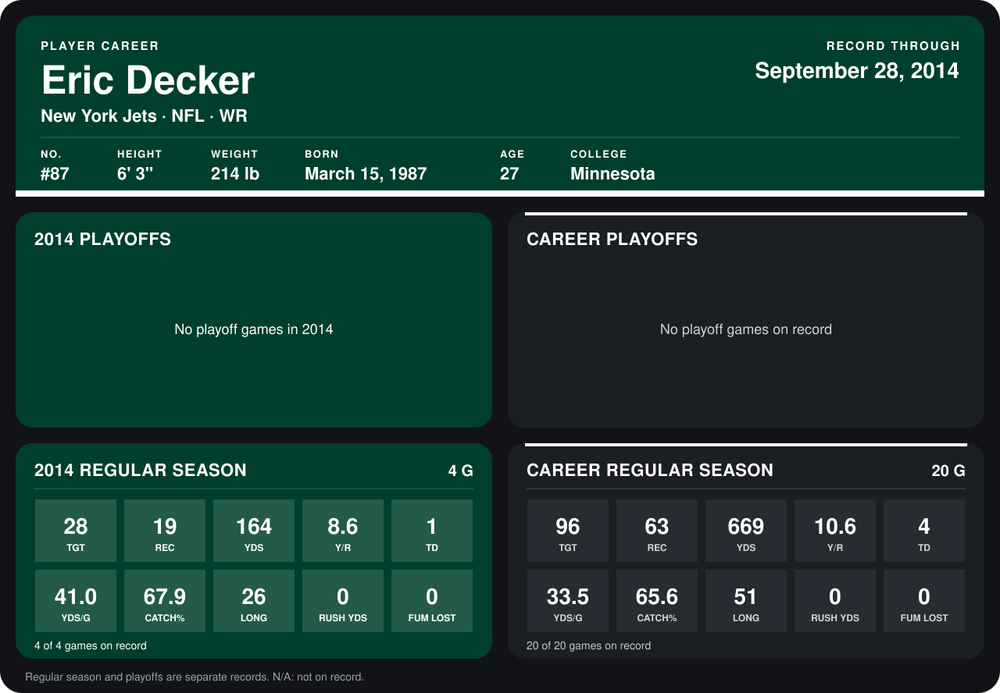

# Eric Decker

## Career stats

### Regular season

| Season | Club | G | TGT | REC | YDS | Y/R | TD | YDS/G | CATCH% | LONG | RUSH YDS | FUM LOST |
|---|---|---:|---:|---:|---:|---:|---:|---:|---:|---:|---:|---:|
| 2013 | Denver Broncos | 16 | 68 | 44 | 505 | 11.5 | 3 | 31.6 | 64.7 | 51 | 0 | 0 |
| 2014 | New York Jets | 4 | 28 | 19 | 164 | 8.6 | 1 | 41.0 | 67.9 | 26 | 0 | 0 |
| **Career** |  | 20 | 96 | 63 | 669 | 10.6 | 4 | 33.5 | 65.6 | 51 | 0 | 0 |

### Playoffs

No playoff games on record.

## Awards

None on record.

Records through September 29, 2014. Identity: listed 2014 roster data, Weeks 1-4; number: 2014 Week 1 roster. [All New York Jets players](README.md).
