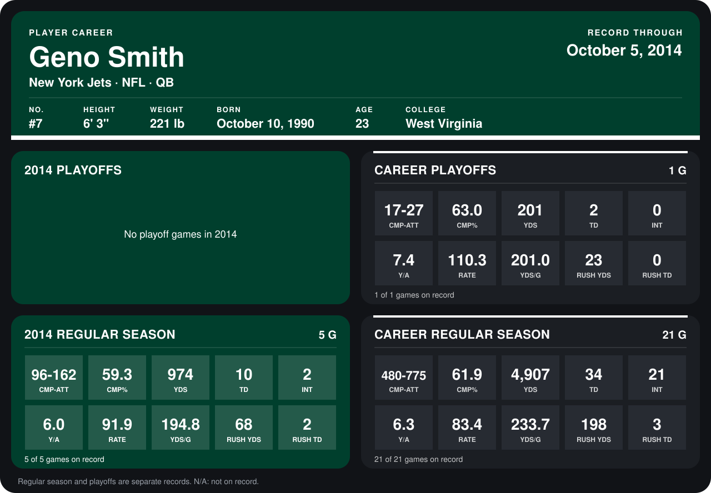

# Geno Smith

## Career stats

### Regular season

| Season | Club | G | CMP-ATT | CMP% | YDS | TD | INT | Y/A | RATE | YDS/G | RUSH YDS | RUSH TD |
|---|---|---:|---:|---:|---:|---:|---:|---:|---:|---:|---:|---:|
| 2013 | New York Jets | 16 | 384-613 | 62.6 | 3,933 | 24 | 19 | 6.4 | 81.2 | 245.8 | 130 | 1 |
| 2014 | New York Jets | 4 | 81-137 | 59.1 | 750 | 8 | 1 | 5.5 | 90.6 | 187.5 | 62 | 2 |
| **Career** |  | 20 | 465-750 | 62.0 | 4,683 | 32 | 20 | 6.2 | 82.9 | 234.2 | 192 | 3 |

### Playoffs

| Season | Club | G | CMP-ATT | CMP% | YDS | TD | INT | Y/A | RATE | YDS/G | RUSH YDS | RUSH TD |
|---|---|---:|---:|---:|---:|---:|---:|---:|---:|---:|---:|---:|
| 2013 | New York Jets | 1 | 17-27 | 63.0 | 201 | 2 | 0 | 7.4 | 110.3 | 201.0 | 23 | 0 |
| **Career** |  | 1 | 17-27 | 63.0 | 201 | 2 | 0 | 7.4 | 110.3 | 201.0 | 23 | 0 |

## Awards

- AFC Offensive Player of the Week (2013, Week 8)
- AP Offensive Rookie of the Year (2013)

Records through September 29, 2014. Identity: listed 2014 roster data, Weeks 1-4; number: 2014 Week 1 roster. [All New York Jets players](README.md).
