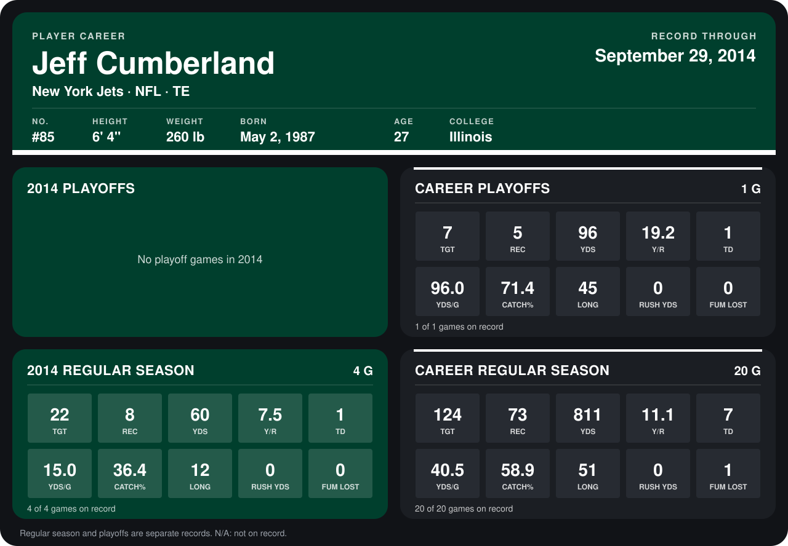

# Jeff Cumberland

## Career stats

### Regular season

| Season | Club | G | TGT | REC | YDS | Y/R | TD | YDS/G | CATCH% | LONG | RUSH YDS | FUM LOST |
|---|---|---:|---:|---:|---:|---:|---:|---:|---:|---:|---:|---:|
| 2013 | New York Jets | 16 | 102 | 65 | 751 | 11.6 | 6 | 46.9 | 63.7 | 51 | 0 | 1 |
| 2014 | New York Jets | 4 | 22 | 8 | 60 | 7.5 | 1 | 15.0 | 36.4 | 12 | 0 | 0 |
| **Career** |  | 20 | 124 | 73 | 811 | 11.1 | 7 | 40.5 | 58.9 | 51 | 0 | 1 |

### Playoffs

| Season | Club | G | TGT | REC | YDS | Y/R | TD | YDS/G | CATCH% | LONG | RUSH YDS | FUM LOST |
|---|---|---:|---:|---:|---:|---:|---:|---:|---:|---:|---:|---:|
| 2013 | New York Jets | 1 | 7 | 5 | 96 | 19.2 | 1 | 96.0 | 71.4 | 45 | 0 | 0 |
| **Career** |  | 1 | 7 | 5 | 96 | 19.2 | 1 | 96.0 | 71.4 | 45 | 0 | 0 |

## Awards

- AP Second-Team All-Pro (2013, TE)

Records through September 29, 2014. Identity: listed 2014 roster data, Weeks 1-4; number: 2014 Week 1 roster. [All New York Jets players](README.md).
