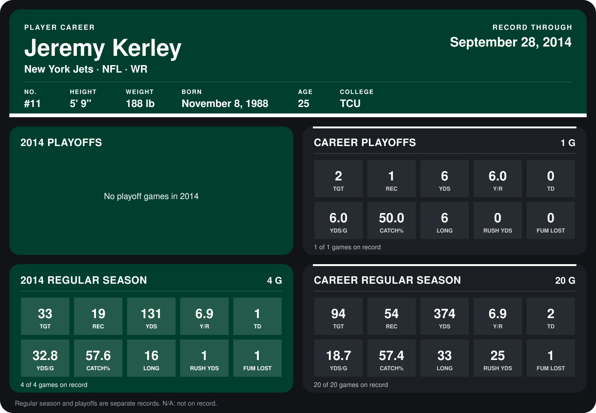

# Jeremy Kerley

## Career stats

### Regular season

| Season | Team | Age | # | G | TGT | REC | YDS | Y/R | TD | YDS/G | CATCH% | LONG | RUSH YDS | FUM LOST |
|---|---|---:|---:|---:|---:|---:|---:|---:|---:|---:|---:|---:|---:|---:|
| 2013 | New York Jets | 24 | 11 | 16 | 61 | 35 | 243 | 6.9 | 1 | 15.2 | 57.4 | 33 | 24 | 0 |
| 2014 | New York Jets | 25 | 11 | 5 | 43 | 25 | 211 | 8.4 | 2 | 42.2 | 58.1 | 24 | 1 | 2 |
| **Career** |  |  |  | 21 | 104 | 60 | 454 | 7.6 | 3 | 21.6 | 57.7 | 33 | 25 | 2 |

### Playoffs

| Season | Team | Age | # | G | TGT | REC | YDS | Y/R | TD | YDS/G | CATCH% | LONG | RUSH YDS | FUM LOST |
|---|---|---:|---:|---:|---:|---:|---:|---:|---:|---:|---:|---:|---:|---:|
| 2013 | New York Jets | 24 | 11 | 1 | 2 | 1 | 6 | 6.0 | 0 | 6.0 | 50.0 | 6 | 0 | 0 |
| **Career** |  |  |  | 1 | 2 | 1 | 6 | 6.0 | 0 | 6.0 | 50.0 | 6 | 0 | 0 |

## Awards

None on record.

Age is his age on the league's opening game of each season; # is the number listed for him that season with that team (2014: the card's rule; 2013: the 2013 season roster), N/A where no listing applies.

Records through October 5, 2014. Identity: listed 2014 roster data, Weeks 1-4; number: 2014 Week 1 roster. [All New York Jets players](README.md).
