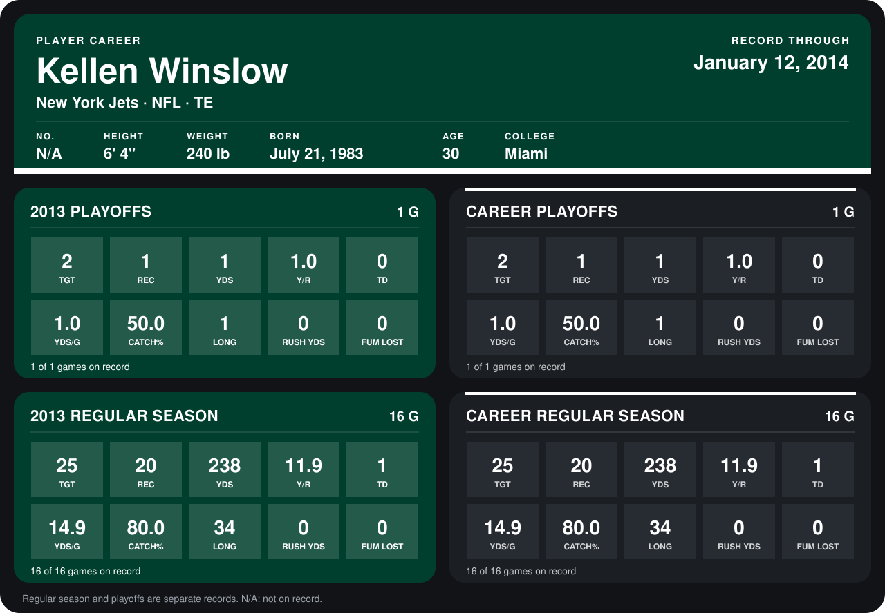

# Kellen Winslow

## Career stats

### Regular season

| Season | Team | Age | # | G | TGT | REC | YDS | Y/R | TD | YDS/G | CATCH% | LONG | RUSH YDS | FUM LOST |
|---|---|---:|---:|---:|---:|---:|---:|---:|---:|---:|---:|---:|---:|---:|
| 2013 | New York Jets | 30 | 81 | 16 | 25 | 20 | 238 | 11.9 | 1 | 14.9 | 80.0 | 34 | 0 | 0 |
| **Career** |  |  |  | 16 | 25 | 20 | 238 | 11.9 | 1 | 14.9 | 80.0 | 34 | 0 | 0 |

### Playoffs

| Season | Team | Age | # | G | TGT | REC | YDS | Y/R | TD | YDS/G | CATCH% | LONG | RUSH YDS | FUM LOST |
|---|---|---:|---:|---:|---:|---:|---:|---:|---:|---:|---:|---:|---:|---:|
| 2013 | New York Jets | 30 | 81 | 1 | 2 | 1 | 1 | 1.0 | 0 | 1.0 | 50.0 | 1 | 0 | 0 |
| **Career** |  |  |  | 1 | 2 | 1 | 1 | 1.0 | 0 | 1.0 | 50.0 | 1 | 0 | 0 |

## Awards

None on record.

Age is his age on the league's opening game of each season; # is the number listed for him that season with that team (2014: the card's rule; 2013: the 2013 season roster), N/A where no listing applies.

Records through January 12, 2014. Identity: his listed 2013 season roster data (no 2014 Weeks 1-4 roster row). [All New York Jets players](README.md).
