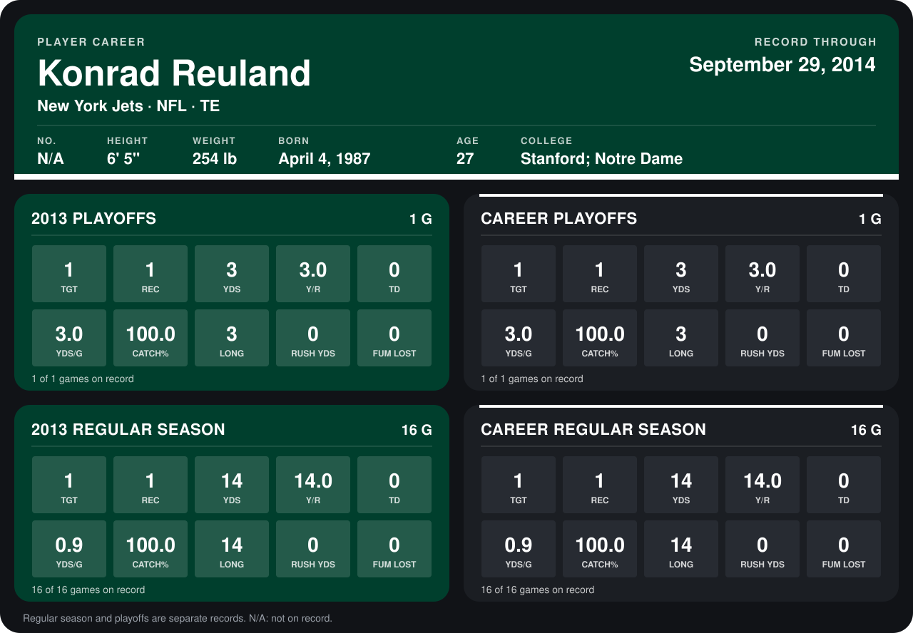

# Konrad Reuland

## Career stats

### Regular season

| Season | Club | G | TGT | REC | YDS | Y/R | TD | YDS/G | CATCH% | LONG | RUSH YDS | FUM LOST |
|---|---|---:|---:|---:|---:|---:|---:|---:|---:|---:|---:|---:|
| 2013 | New York Jets | 16 | 1 | 1 | 14 | 14.0 | 0 | 0.9 | 100.0 | 14 | 0 | 0 |
| **Career** |  | 16 | 1 | 1 | 14 | 14.0 | 0 | 0.9 | 100.0 | 14 | 0 | 0 |

### Playoffs

| Season | Club | G | TGT | REC | YDS | Y/R | TD | YDS/G | CATCH% | LONG | RUSH YDS | FUM LOST |
|---|---|---:|---:|---:|---:|---:|---:|---:|---:|---:|---:|---:|
| 2013 | New York Jets | 1 | 1 | 1 | 3 | 3.0 | 0 | 3.0 | 100.0 | 3 | 0 | 0 |
| **Career** |  | 1 | 1 | 1 | 3 | 3.0 | 0 | 3.0 | 100.0 | 3 | 0 | 0 |

## Awards

None on record.

Records through January 12, 2014. Identity: his listed 2013 season roster data (no 2014 Weeks 1-4 roster row). [All New York Jets players](README.md).
