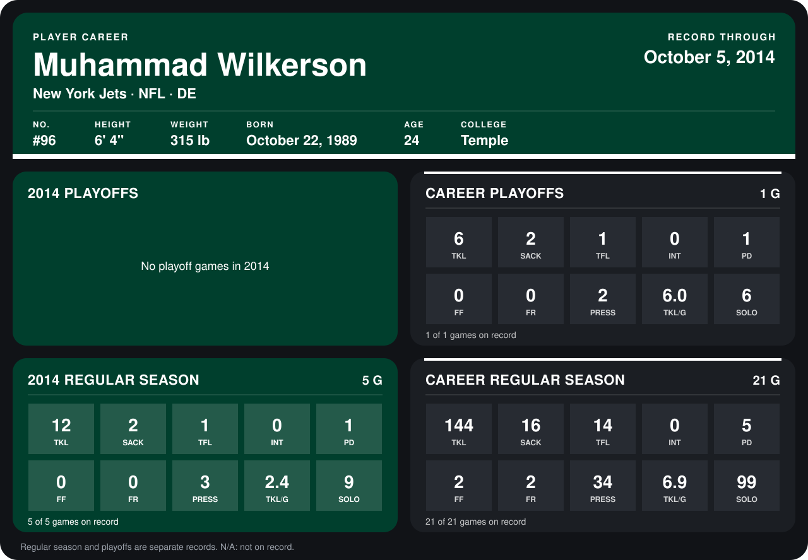

# Muhammad Wilkerson

## Career stats

### Regular season

| Season | Club | G | TKL | SACK | TFL | INT | PD | FF | FR | PRESS | TKL/G | SOLO |
|---|---|---:|---:|---:|---:|---:|---:|---:|---:|---:|---:|---:|
| 2013 | New York Jets | 16 | 132 | 14 | 13 | 0 | 4 | 2 | 2 | 31 | 8.2 | 90 |
| 2014 | New York Jets | 4 | 10 | 2 | 1 | 0 | 1 | 0 | 0 | 3 | 2.5 | 8 |
| **Career** |  | 20 | 142 | 16 | 14 | 0 | 5 | 2 | 2 | 34 | 7.1 | 98 |

### Playoffs

| Season | Club | G | TKL | SACK | TFL | INT | PD | FF | FR | PRESS | TKL/G | SOLO |
|---|---|---:|---:|---:|---:|---:|---:|---:|---:|---:|---:|---:|
| 2013 | New York Jets | 1 | 6 | 2 | 1 | 0 | 1 | 0 | 0 | 2 | 6.0 | 6 |
| **Career** |  | 1 | 6 | 2 | 1 | 0 | 1 | 0 | 0 | 2 | 6.0 | 6 |

## Awards

- AFC Defensive Player of the Week (2013, Week 7)
- AFC Defensive Player of the Week (2013, Week 15)
- AP First-Team All-Pro (2013, DE)
- Pro Bowl selection (2013, DE)

Records through September 28, 2014. Identity: listed 2014 roster data, Weeks 1-4; number: 2014 Week 1 roster. [All New York Jets players](README.md).
