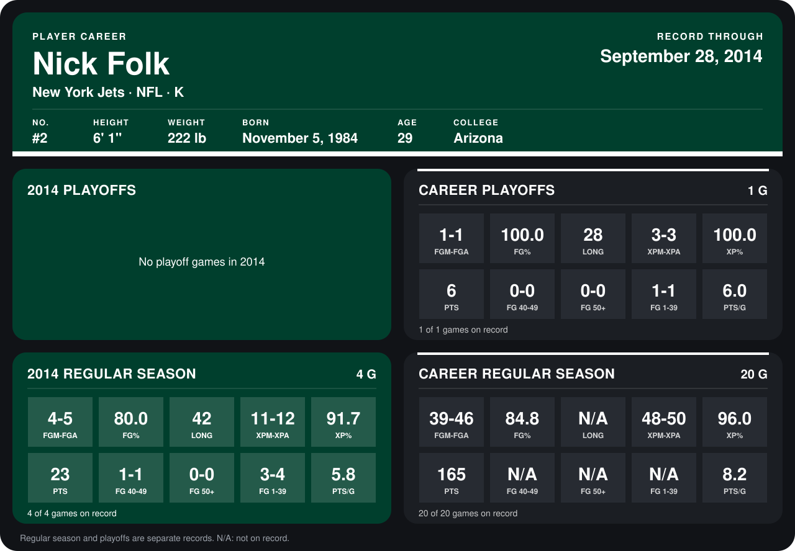

# Nick Folk

## Career stats

### Regular season

| Season | Team | Age | # | G | FGM-FGA | FG% | LONG | XPM-XPA | XP% | PTS | FG 40-49 | FG 50+ | FG 1-39 | PTS/G |
|---|---|---:|---:|---:|---:|---:|---:|---:|---:|---:|---:|---:|---:|---:|
| 2013 | New York Jets | 28 | 2 | 16 | 35-41 | 85.4 | N/A | 37-38 | 97.4 | 142 | N/A | N/A | N/A | 8.9 |
| 2014 | New York Jets | 29 | 2 | 4 | 4-5 | 80.0 | 42 | 11-12 | 91.7 | 23 | 1-1 | 0-0 | 3-4 | 5.8 |
| **Career** |  |  |  | 20 | 39-46 | 84.8 | N/A | 48-50 | 96.0 | 165 | N/A | N/A | N/A | 8.2 |

### Playoffs

| Season | Team | Age | # | G | FGM-FGA | FG% | LONG | XPM-XPA | XP% | PTS | FG 40-49 | FG 50+ | FG 1-39 | PTS/G |
|---|---|---:|---:|---:|---:|---:|---:|---:|---:|---:|---:|---:|---:|---:|
| 2013 | New York Jets | 28 | 2 | 1 | 1-1 | 100.0 | 28 | 3-3 | 100.0 | 6 | 0-0 | 0-0 | 1-1 | 6.0 |
| **Career** |  |  |  | 1 | 1-1 | 100.0 | 28 | 3-3 | 100.0 | 6 | 0-0 | 0-0 | 1-1 | 6.0 |

## Awards

- AFC Special Teams Player of the Week (2013, Week 1)
- AFC Special Teams Player of the Month (2013, October)

Age is his age on the league's opening game of each season; # is the number listed for him that season with that team (2014: the card's rule; 2013: the 2013 season roster), N/A where no listing applies.

Records through September 28, 2014. Identity: listed 2014 roster data, Weeks 1-4; number: 2014 Week 1 roster. [All New York Jets players](README.md).
