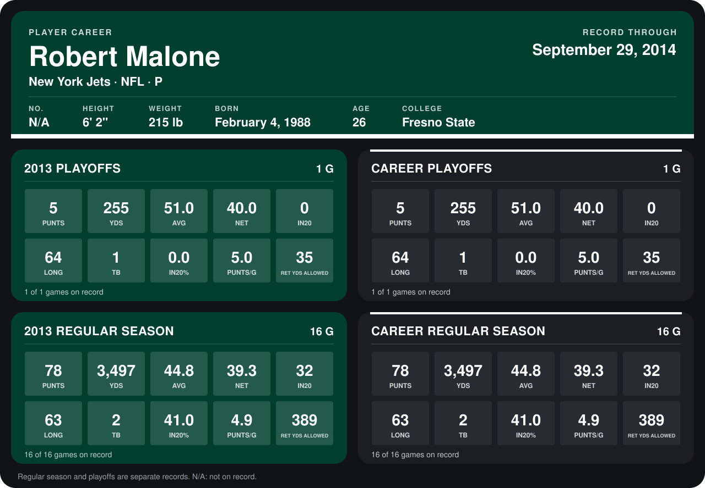

# Robert Malone

## Career stats

### Regular season

| Season | Team | Age | # | G | PUNTS | YDS | AVG | NET | IN20 | LONG | TB | IN20% | PUNTS/G | RET YDS ALLOWED |
|---|---|---:|---:|---:|---:|---:|---:|---:|---:|---:|---:|---:|---:|---:|
| 2013 | New York Jets | 25 | 3 | 16 | 78 | 3,497 | 44.8 | 39.3 | 32 | 63 | 2 | 41.0 | 4.9 | 389 |
| **Career** |  |  |  | 16 | 78 | 3,497 | 44.8 | 39.3 | 32 | 63 | 2 | 41.0 | 4.9 | 389 |

### Playoffs

| Season | Team | Age | # | G | PUNTS | YDS | AVG | NET | IN20 | LONG | TB | IN20% | PUNTS/G | RET YDS ALLOWED |
|---|---|---:|---:|---:|---:|---:|---:|---:|---:|---:|---:|---:|---:|---:|
| 2013 | New York Jets | 25 | 3 | 1 | 5 | 255 | 51.0 | 40.0 | 0 | 64 | 1 | 0.0 | 5.0 | 35 |
| **Career** |  |  |  | 1 | 5 | 255 | 51.0 | 40.0 | 0 | 64 | 1 | 0.0 | 5.0 | 35 |

## Awards

None on record.

Age is his age on the league's opening game of each season; # is the number listed for him that season with that team (2014: the card's rule; 2013: the 2013 season roster), N/A where no listing applies.

Records through January 12, 2014. Identity: his listed 2013 season roster data (no 2014 Weeks 1-4 roster row). [All New York Jets players](README.md).
