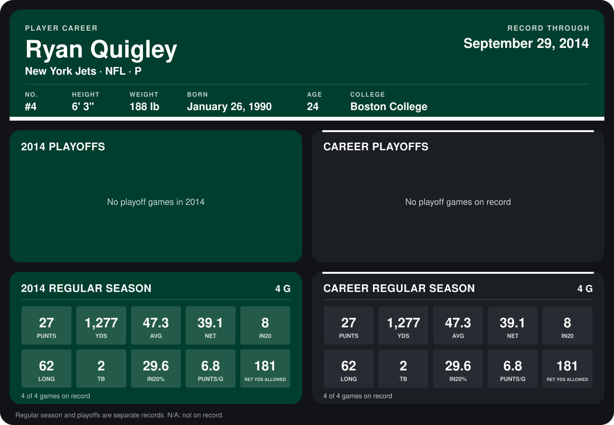

# Ryan Quigley

## Career stats

### Regular season

| Season | Club | G | PUNTS | YDS | AVG | NET | IN20 | LONG | TB | IN20% | PUNTS/G | RET YDS ALLOWED |
|---|---|---:|---:|---:|---:|---:|---:|---:|---:|---:|---:|---:|
| 2014 | New York Jets | 4 | 27 | 1,277 | 47.3 | 39.1 | 8 | 62 | 2 | 29.6 | 6.8 | 181 |
| **Career** |  | 4 | 27 | 1,277 | 47.3 | 39.1 | 8 | 62 | 2 | 29.6 | 6.8 | 181 |

### Playoffs

No playoff games on record.

## Awards

None on record.

Records through September 28, 2014. Identity: listed 2014 roster data, Weeks 1-4; number: 2014 Week 1 roster. [All New York Jets players](README.md).
