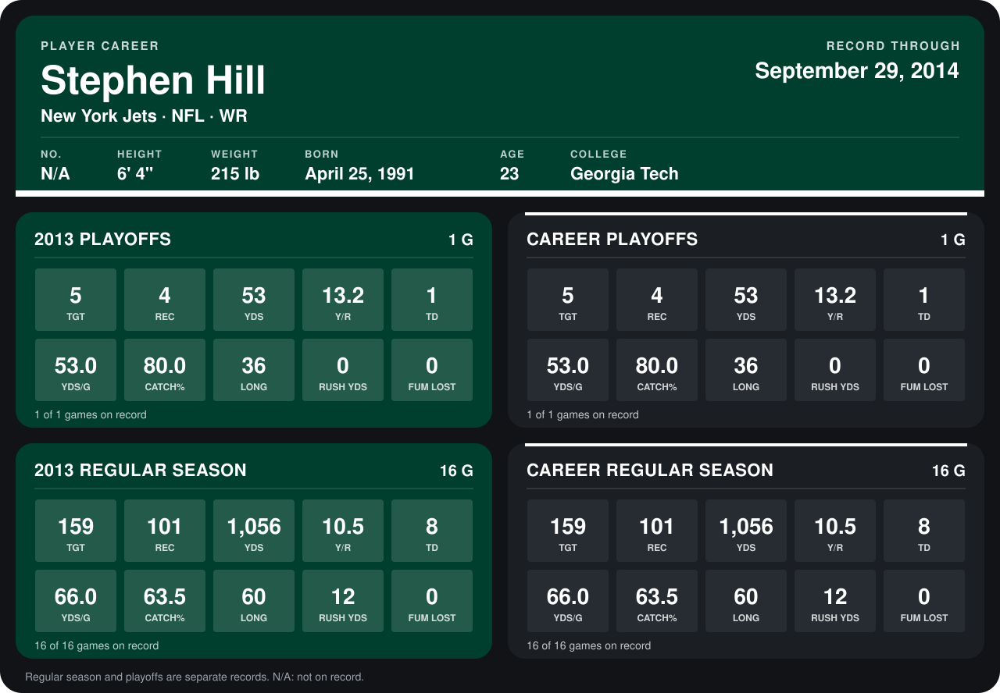

# Stephen Hill

## Career stats

### Regular season

| Season | Club | G | TGT | REC | YDS | Y/R | TD | YDS/G | CATCH% | LONG | RUSH YDS | FUM LOST |
|---|---|---:|---:|---:|---:|---:|---:|---:|---:|---:|---:|---:|
| 2013 | New York Jets | 16 | 159 | 101 | 1,056 | 10.5 | 8 | 66.0 | 63.5 | 60 | 12 | 0 |
| **Career** |  | 16 | 159 | 101 | 1,056 | 10.5 | 8 | 66.0 | 63.5 | 60 | 12 | 0 |

### Playoffs

| Season | Club | G | TGT | REC | YDS | Y/R | TD | YDS/G | CATCH% | LONG | RUSH YDS | FUM LOST |
|---|---|---:|---:|---:|---:|---:|---:|---:|---:|---:|---:|---:|
| 2013 | New York Jets | 1 | 5 | 4 | 53 | 13.2 | 1 | 53.0 | 80.0 | 36 | 0 | 0 |
| **Career** |  | 1 | 5 | 4 | 53 | 13.2 | 1 | 53.0 | 80.0 | 36 | 0 | 0 |

## Awards

None on record.

Records through September 29, 2014. Identity: the public player file's latest listing (no 2014 Weeks 1-4 roster row). [All New York Jets players](README.md).
