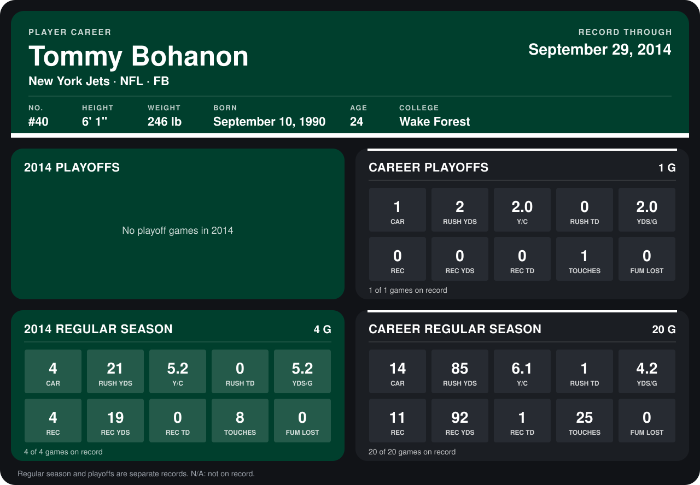

# Tommy Bohanon

## Career stats

### Regular season

| Season | Club | G | CAR | RUSH YDS | Y/C | RUSH TD | YDS/G | REC | REC YDS | REC TD | TOUCHES | FUM LOST |
|---|---|---:|---:|---:|---:|---:|---:|---:|---:|---:|---:|---:|
| 2013 | New York Jets | 16 | 10 | 64 | 6.4 | 1 | 4.0 | 7 | 73 | 1 | 17 | 0 |
| 2014 | New York Jets | 4 | 4 | 21 | 5.2 | 0 | 5.2 | 4 | 19 | 0 | 8 | 0 |
| **Career** |  | 20 | 14 | 85 | 6.1 | 1 | 4.2 | 11 | 92 | 1 | 25 | 0 |

### Playoffs

| Season | Club | G | CAR | RUSH YDS | Y/C | RUSH TD | YDS/G | REC | REC YDS | REC TD | TOUCHES | FUM LOST |
|---|---|---:|---:|---:|---:|---:|---:|---:|---:|---:|---:|---:|
| 2013 | New York Jets | 1 | 1 | 2 | 2.0 | 0 | 2.0 | 0 | 0 | 0 | 1 | 0 |
| **Career** |  | 1 | 1 | 2 | 2.0 | 0 | 2.0 | 0 | 0 | 0 | 1 | 0 |

## Awards

None on record.

Records through September 29, 2014. Identity: listed 2014 roster data, Weeks 1-4; number: 2014 Week 1 roster. [All New York Jets players](README.md).
