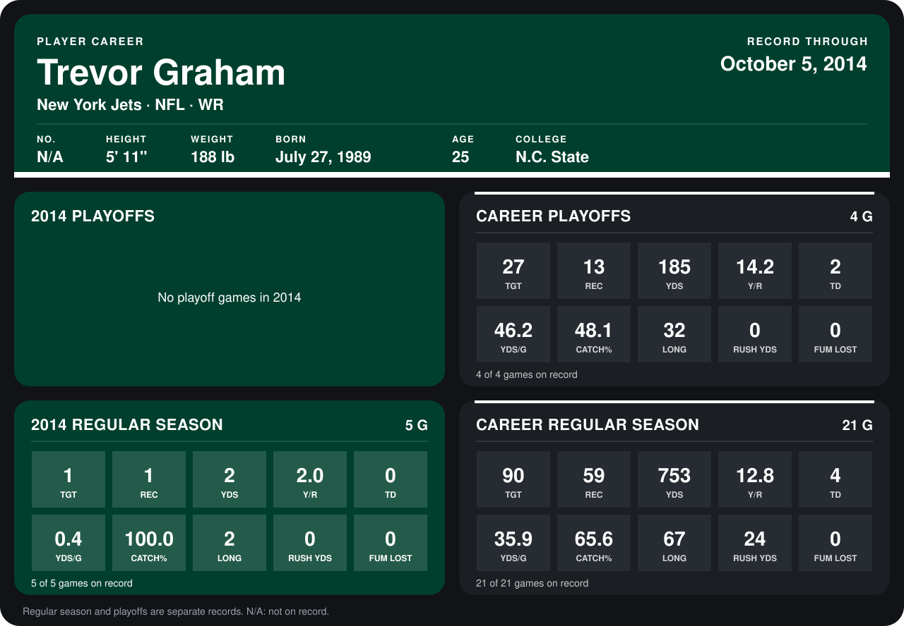

# Trevor Graham

## Career stats

### Regular season

| Season | Team | Age | # | G | TGT | REC | YDS | Y/R | TD | YDS/G | CATCH% | LONG | RUSH YDS | FUM LOST |
|---|---|---:|---:|---:|---:|---:|---:|---:|---:|---:|---:|---:|---:|---:|
| 2013 | Buffalo Bills | 24 | 11 | 16 | 89 | 58 | 751 | 12.9 | 4 | 46.9 | 65.2 | 67 | 24 | 0 |
| 2014 | Tennessee Titans, New York Jets | 25 | N/A | 5 | 1 | 1 | 2 | 2.0 | 0 | 0.4 | 100.0 | 2 | 0 | 0 |
| **Career** |  |  |  | 21 | 90 | 59 | 753 | 12.8 | 4 | 35.9 | 65.6 | 67 | 24 | 0 |

### Playoffs

| Season | Team | Age | # | G | TGT | REC | YDS | Y/R | TD | YDS/G | CATCH% | LONG | RUSH YDS | FUM LOST |
|---|---|---:|---:|---:|---:|---:|---:|---:|---:|---:|---:|---:|---:|---:|
| 2013 | Buffalo Bills | 24 | 11 | 4 | 27 | 13 | 185 | 14.2 | 2 | 46.2 | 48.1 | 32 | 0 | 0 |
| **Career** |  |  |  | 4 | 27 | 13 | 185 | 14.2 | 2 | 46.2 | 48.1 | 32 | 0 | 0 |

## Awards

None on record.

Age is his age on the league's opening game of each season; # is the number listed for him that season with that team (2014: the card's rule; 2013: the 2013 season roster), N/A where no listing applies.

Records through October 5, 2014. Identity: listed 2014 roster data, Weeks 1-4. [All New York Jets players](README.md).
