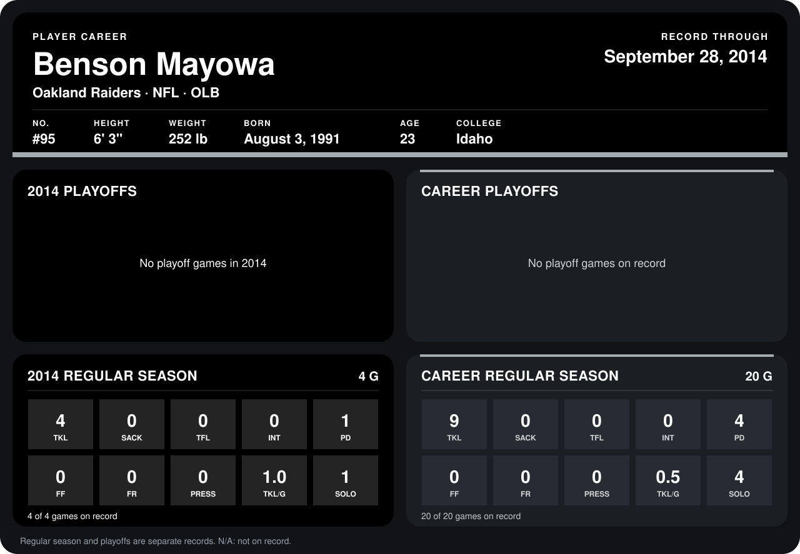

# Benson Mayowa

## Career stats

### Regular season

| Season | Club | G | TKL | SACK | TFL | INT | PD | FF | FR | PRESS | TKL/G | SOLO |
|---|---|---:|---:|---:|---:|---:|---:|---:|---:|---:|---:|---:|
| 2013 | Seattle Seahawks | 16 | 5 | 0 | 0 | 0 | 3 | 0 | 0 | 0 | 0.3 | 3 |
| 2014 | Oakland Raiders | 4 | 4 | 0 | 0 | 0 | 1 | 0 | 0 | 0 | 1.0 | 1 |
| **Career** |  | 20 | 9 | 0 | 0 | 0 | 4 | 0 | 0 | 0 | 0.5 | 4 |

### Playoffs

No playoff games on record.

## Awards

None on record.

Records through September 29, 2014. Identity: listed 2014 roster data, Weeks 1-4; number: 2014 Week 1 roster. [All Oakland Raiders players](README.md).
