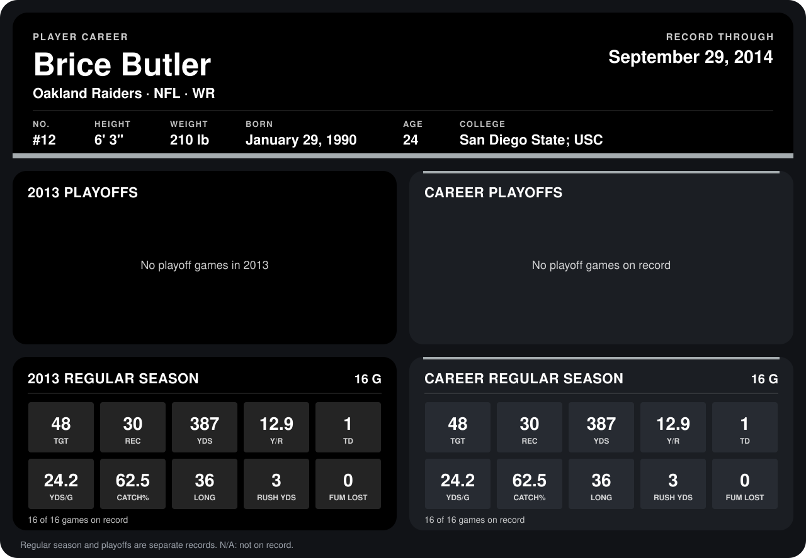

# Brice Butler

## Career stats

### Regular season

| Season | Club | G | TGT | REC | YDS | Y/R | TD | YDS/G | CATCH% | LONG | RUSH YDS | FUM LOST |
|---|---|---:|---:|---:|---:|---:|---:|---:|---:|---:|---:|---:|
| 2013 | Oakland Raiders | 16 | 48 | 30 | 387 | 12.9 | 1 | 24.2 | 62.5 | 36 | 3 | 0 |
| **Career** |  | 16 | 48 | 30 | 387 | 12.9 | 1 | 24.2 | 62.5 | 36 | 3 | 0 |

### Playoffs

No playoff games on record.

## Awards

None on record.

Records through December 29, 2013. Identity: listed 2014 roster data, Weeks 1-4; number: 2014 Week 4 roster listing. [All Oakland Raiders players](README.md).
