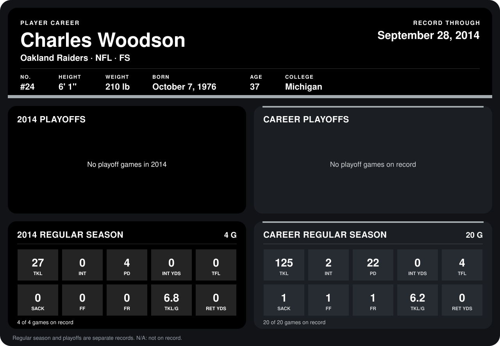

# Charles Woodson

## Career stats

### Regular season

| Season | Club | G | TKL | INT | PD | INT YDS | TFL | SACK | FF | FR | TKL/G | RET YDS |
|---|---|---:|---:|---:|---:|---:|---:|---:|---:|---:|---:|---:|
| 2013 | Oakland Raiders | 16 | 98 | 2 | 18 | 0 | 4 | 1 | 1 | 1 | 6.1 | 0 |
| 2014 | Oakland Raiders | 4 | 27 | 0 | 4 | 0 | 0 | 0 | 0 | 0 | 6.8 | 0 |
| **Career** |  | 20 | 125 | 2 | 22 | 0 | 4 | 1 | 1 | 1 | 6.2 | 0 |

### Playoffs

No playoff games on record.

## Awards

None on record.

Records through September 29, 2014. Identity: listed 2014 roster data, Weeks 1-4; number: 2014 Week 1 roster. [All Oakland Raiders players](README.md).
