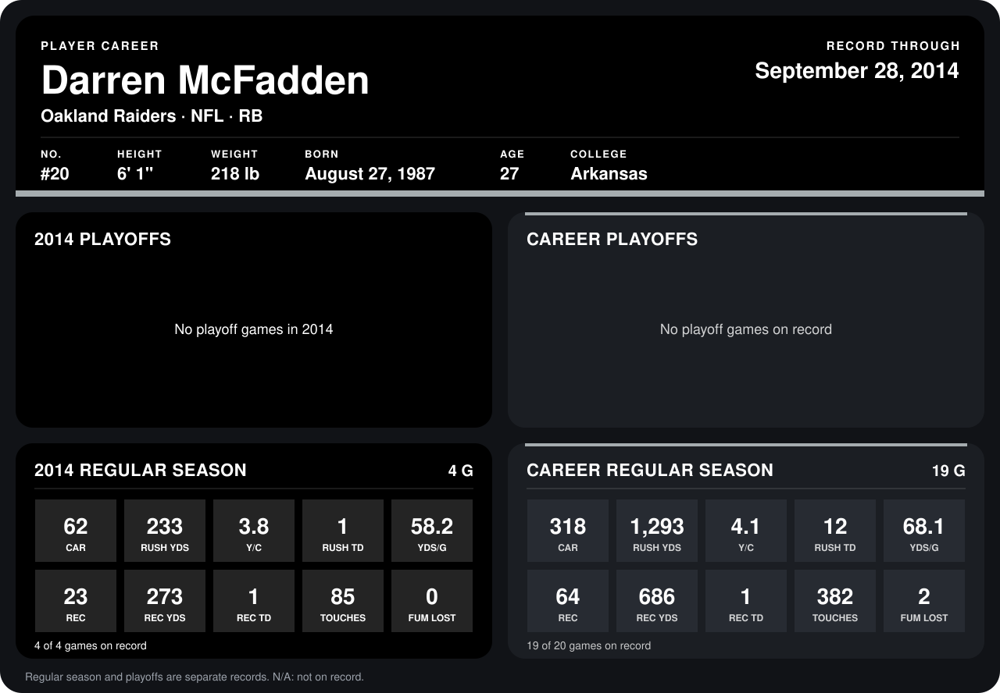

# Darren McFadden

## Career stats

### Regular season

| Season | Club | G | CAR | RUSH YDS | Y/C | RUSH TD | YDS/G | REC | REC YDS | REC TD | TOUCHES | FUM LOST |
|---|---|---:|---:|---:|---:|---:|---:|---:|---:|---:|---:|---:|
| 2013 | Oakland Raiders | 15 | 256 | 1,060 | 4.1 | 11 | 70.7 | 41 | 413 | 0 | 297 | 2 |
| 2014 | Oakland Raiders | 4 | 62 | 233 | 3.8 | 1 | 58.2 | 23 | 273 | 1 | 85 | 0 |
| **Career** |  | 19 | 318 | 1,293 | 4.1 | 12 | 68.1 | 64 | 686 | 1 | 382 | 2 |

### Playoffs

No playoff games on record.

## Awards

- AFC Offensive Player of the Week (2014, Week 1)

Records through September 28, 2014. Identity: listed 2014 roster data, Weeks 1-4; number: 2014 Week 1 roster. [All Oakland Raiders players](README.md).
