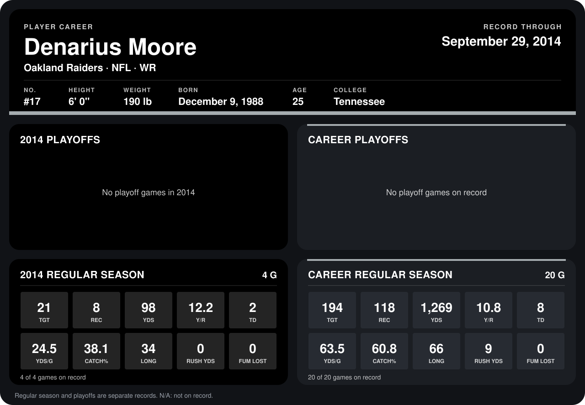

# Denarius Moore

## Career stats

### Regular season

| Season | Club | G | TGT | REC | YDS | Y/R | TD | YDS/G | CATCH% | LONG | RUSH YDS | FUM LOST |
|---|---|---:|---:|---:|---:|---:|---:|---:|---:|---:|---:|---:|
| 2013 | Oakland Raiders | 16 | 173 | 110 | 1,171 | 10.6 | 6 | 73.2 | 63.6 | 66 | 9 | 0 |
| 2014 | Oakland Raiders | 4 | 21 | 8 | 98 | 12.2 | 2 | 24.5 | 38.1 | 34 | 0 | 0 |
| **Career** |  | 20 | 194 | 118 | 1,269 | 10.8 | 8 | 63.5 | 60.8 | 66 | 9 | 0 |

### Playoffs

No playoff games on record.

## Awards

None on record.

Records through September 29, 2014. Identity: listed 2014 roster data, Weeks 1-4; number: 2014 Week 1 roster. [All Oakland Raiders players](README.md).
