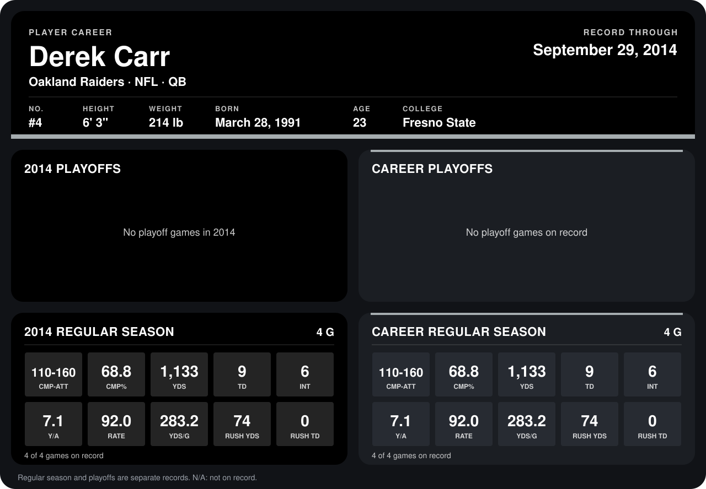

# Derek Carr

## Career stats

### Regular season

| Season | Club | G | CMP-ATT | CMP% | YDS | TD | INT | Y/A | RATE | YDS/G | RUSH YDS | RUSH TD |
|---|---|---:|---:|---:|---:|---:|---:|---:|---:|---:|---:|---:|
| 2014 | Oakland Raiders | 4 | 110-160 | 68.8 | 1,133 | 9 | 6 | 7.1 | 92.0 | 283.2 | 74 | 0 |
| **Career** |  | 4 | 110-160 | 68.8 | 1,133 | 9 | 6 | 7.1 | 92.0 | 283.2 | 74 | 0 |

### Playoffs

No playoff games on record.

## Awards

None on record.

Records through September 28, 2014. Identity: listed 2014 roster data, Weeks 1-4; number: 2014 Week 1 roster. [All Oakland Raiders players](README.md).
