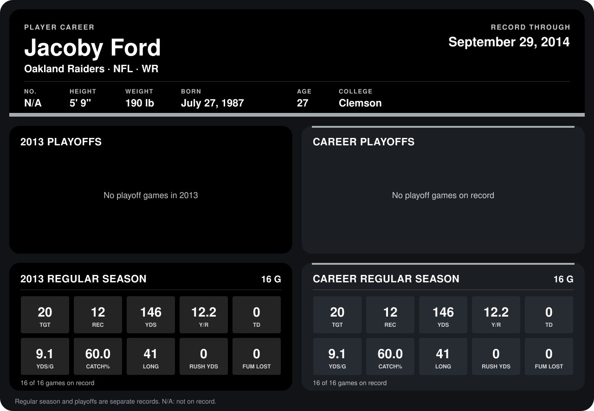

# Jacoby Ford

## Career stats

### Regular season

| Season | Team | Age | # | G | TGT | REC | YDS | Y/R | TD | YDS/G | CATCH% | LONG | RUSH YDS | FUM LOST |
|---|---|---:|---:|---:|---:|---:|---:|---:|---:|---:|---:|---:|---:|---:|
| 2013 | Oakland Raiders | 26 | 12 | 16 | 20 | 12 | 146 | 12.2 | 0 | 9.1 | 60.0 | 41 | 0 | 0 |
| **Career** |  |  |  | 16 | 20 | 12 | 146 | 12.2 | 0 | 9.1 | 60.0 | 41 | 0 | 0 |

### Playoffs

No playoff games on record.

## Awards

- AFC Special Teams Player of the Week (2013, Week 14)

Age is his age on the league's opening game of each season; # is the number listed for him that season with that team (2014: the card's rule; 2013: the 2013 season roster), N/A where no listing applies.

Records through December 29, 2013. Identity: his listed 2013 season roster data (no 2014 Weeks 1-4 roster row). [All Oakland Raiders players](README.md).
