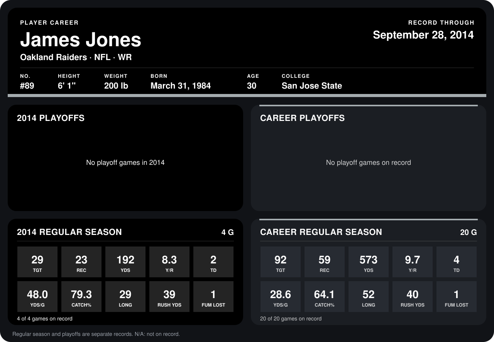

# James Jones

## Career stats

### Regular season

| Season | Club | G | TGT | REC | YDS | Y/R | TD | YDS/G | CATCH% | LONG | RUSH YDS | FUM LOST |
|---|---|---:|---:|---:|---:|---:|---:|---:|---:|---:|---:|---:|
| 2013 | Green Bay Packers | 16 | 63 | 36 | 381 | 10.6 | 2 | 23.8 | 57.1 | 52 | 1 | 0 |
| 2014 | Oakland Raiders | 4 | 29 | 23 | 192 | 8.3 | 2 | 48.0 | 79.3 | 29 | 39 | 1 |
| **Career** |  | 20 | 92 | 59 | 573 | 9.7 | 4 | 28.6 | 64.1 | 52 | 40 | 1 |

### Playoffs

No playoff games on record.

## Awards

None on record.

Records through September 28, 2014. Identity: listed 2014 roster data, Weeks 1-4; number: 2014 Week 1 roster. [All Oakland Raiders players](README.md).
